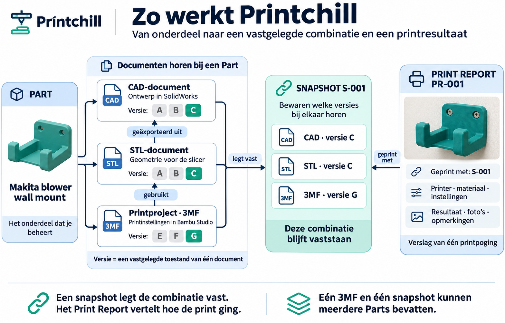

# PrintChill — Architectuur en begrippen

## Inhoudsopgave

- [Naamgeving](#naamgeving)
- [Datamodel voor gebruikers](#datamodel-voor-gebruikers)
- [Definities](#definities)
- [Relaties](#relaties)
- [Regels](#regels)
- [UI-uitgangspunten](#ui-uitgangspunten)
- [Open ontwerpvragen](#open-ontwerpvragen)

## Naamgeving

Samana ontleent zijn betekenis aan de gereconstrueerde Germaanse vorm *samana*, die ‘samen’ of ‘gezamenlijk’ betekent en verwant is aan het Oudnoordse *saman*. Als bedrijfsnaam staat het voor het samenbrengen van ideeën, mensen en techniek: van een eerste klantvraag naar een doordacht ontwerp en een tastbaar product. Daarmee past Samana bij 3D-printen, CAD-ontwerp en maatwerk, terwijl de naam ook ruimte biedt voor toekomstige engineeringactiviteiten. De vloeiende, internationaal klinkende naam heeft een rustigere en professionelere uitstraling dan Printchill en legt de nadruk op samenwerking en oplossingen. Samana wordt al door andere organisaties gebruikt; de geschiktheid als merknaam voor jouw activiteiten moet daarom nog worden vastgesteld.

## Datamodel voor gebruikers

Conceptueel model; geen vastgesteld databaseschema of gerealiseerde applicatie. De afbeelding is de eerdere gebruikersrendering en is achterhaald voor Part versions en Print Reports; onderstaande definities zijn leidend.

## Definities

| Begrip | Definitie | Voorbeeld |
| --- | --- | --- |
| **Part** | Het logische onderdeel met een vaste identiteit, onafhankelijk van bestandsnamen en versies. ‘Object’ is een technische verzamelterm; geen aparte gebruikersentiteit | Makita blower wall mount, partnummer 7382-4916 |
| **Document** | Een beheerd bestand met eigen identiteit en versiehistorie. Een document kan verschillende vastgelegde versies hebben | SolidWorks-part, STL-document of 3MF-printproject |
| **Documentrevisie** | Een vastgelegde, onveranderlijke toestand van één document, inclusief inhoud en bijbehorende metadata | CAD C, STL C of 3MF G |
| **Part version** | Onveranderlijke geregistreerde toestand van een PRC Part met exacte CAD-, STL- en 3MF-revisies. Nummer start bij 001 en telt op bij bestandswijzigingen | Part 7382-4916, version 003: CAD C, STL C, 3MF G |
| **Snapshot** | Latere baseliningfunctionaliteit; geen extra verplichte laag voor de dagelijkse Part-workflow. Scope nog uit te werken | S-001 bevat CAD C, STL C en 3MF G |
| **Print Report** | Verslag van één daadwerkelijke printpoging, gekoppeld aan de gebruikte Part version; bevat printer, materiaal, beschikbare instellingen, resultaat, metingen, foto's en opmerkingen | PR-001 beschrijft een print van Part version 003 |
| **Status** | Afzonderlijk te ontwerpen eigenschap. Voorlopige termen: `draft`, `print-candidate`, `printed`, `scrap`; niveau en overgangen zijn nog niet vastgesteld | Geen impliciete statusovergang door een save of snapshot |
| **Tag** | Herbruikbaar zoeklabel op Parts; vergelijking op naam is hoofdletterongevoelig | `#roboticarm` |
| **Collectie / project** | Navigatiegroepering uit de gebruikersworkflow; betekenis en onderlinge structuur nog te bepalen | Parts voor een robotarm |

Documentrevisies gebruiken letters; Part versions gebruiken minimaal drie cijfers vanaf 001. Interne IDs identificeren documenten, revisies en Part versions onafhankelijk van labels. Gedrag na 999 staat nog open.

## Relaties

| Relatie | Van → naar | Omgekeerd zichtbaar als |
| --- | --- | --- |
| **Hoort bij** | Document → Part | Documenten |
| **Heeft versie** | Document → Versie | Versie van |
| **Geëxporteerd uit** | STL-versie → CAD-versie met configuratie | Exports |
| **Gebruikt** | 3MF-versie → één of meerdere STL-/modelversies; CAD-assemblyversie → onderdeelversies waar bekend | Waar gebruikt / Where used |
| **Legt vast** | Snapshot → specifieke documentversies en hun bronrelaties | Opgenomen in snapshots |
| **Geprint met** | Print Report → exacte Part version | Print Reports |
| **Bevat** | Part version → exacte documentrevisies | Opgenomen in Part versions |
| **Ondersteunt** | Attachment / Git-verwijzing → Part version | Attachments |
| **Afgeleid van** | Part → ander Part | Afgeleide Parts |
| **Heeft tag** | Part → Tag | Parts met deze tag |

Een standaard CAD- of STL-document hoort bij het betreffende Part. Een 3MF-project en een snapshot kunnen meerdere Parts omvatten; de documentassociaties en bronrelaties mogen daarom niet tot één Part worden beperkt. Onderdeel-/plaatcontext blijft bewaard waar beschikbaar.

## Regels

- CAD, STL en 3MF hebben onafhankelijke versiehistories. De STL-letter hoeft niet gelijk te zijn aan de CAD-letter; de bronrelatie bepaalt de herkomst.
- Een snapshot verwijst naar concrete versies, nooit naar ‘latest’. Nieuwe CAD D of 3MF H verandert S-001 niet.
- Een snapshot kan ook een onbewezen of mislukte combinatie beschrijven. Een Print Report registreert de werkelijke printuitkomst.
- Meerdere Print Reports mogen dezelfde Part version gebruiken. Verschillende pogingen blijven afzonderlijk herkenbaar.
- Een Part kan beginnen met alleen een gedownloade STL. Ontbrekende CAD-herkomst wordt niet verzonnen.
- Een save, gewijzigde bytes, nieuwe documentversie en nieuwe snapshot zijn verschillende gebeurtenissen. Identificatie en inhoudscontrole blijven gescheiden van status.
- Bestandsnaam, timestamp of een gekopieerde custom property zijn op zichzelf geen bewijs van een exacte bronversie. Onzekere koppelingen moeten zichtbaar en te bevestigen zijn.
- Historische versies en snapshotrelaties worden niet stilzwijgend overschreven. Wijzigingen leiden tot nieuwe registraties.
- De v0.2-macro gebruikt `source.active_configuration` voor configuratiecontext. De bestaande JSON-`export_id` identificeert de extractie, geen Part, documentversie of snapshot.

## UI-uitgangspunten

Uit UC-006 t/m UC-009: circa 20% zijbalk met zoeken, filters, collecties en projecten; de overige ruimte toont Part-kaarten. Een kaart toont identiteit, beschikbare versie-/printcontext en tags. Hover/focus kan details tonen; dezelfde functies zijn via klik/toetsenbord bereikbaar.

De 3D-viewer toont welke STL-versie wordt bekeken, met een optionele bounding box en eenheden. Ontbrekende printgegevens blijven onbekend; tijd, materiaal en laatste print krijgen een expliciete 3MF-/Print Report-context binnen de gekozen Part version. Een Part toont zijn expliciete numerieke Part version met de daarin vastgelegde bestandsrevisies.

## Open ontwerpvragen

- Nummergeneratie voor Part numbers, grens na Part version 999, schrijfbeleid en import van bestaande CAD-revisielabels.
- Niveau en overgangen van status; oude UC-term ‘First printed’ is geen vastgesteld extra statuslabel.
- Relatie van collecties en projecten; navigatie en selectie van de standaard-Part-version.
- Betrouwbare bronherkenning en vervanging van STL-geometrie: [[ISSUES#ISS-001]].
- Bewijs en versieondersteuning voor automatische CAD-/slicerextractie; onbekende relaties niet als zeker presenteren.
- Technische opslag, connectors en deployments volgen na de POC; hier niet vastgesteld.

## Gerelateerde documentatie

[[USECASES]] · [[POC]] · [[PDM_VERSIONING_RESEARCH]] · [[SOLIDWORKS_JSON_POC]] · [[DJF]]

## HTML UI-prototype

Zie [prototype](../prototype/README.md): visuele bibliotheek, STL-viewer, onafhankelijke documentrevisies, numerieke Part versions, Logbook, versiegebonden attachments en Print Reports. Gegevens blijven in het browsergeheugen; historische versies en relaties zijn demo’s. Geen backend of CAD-/slicerconnector. Volledige UC-acceptatie blijft open.

## UI-feedback — prototype 2

- Part version 001, 002, … bevat vaste referenties naar één of meerdere CAD/STL-documenten en 3MF, elk met eigen letterrevisie. Eén bevestigde wijzigingsactie levert één Part version, ook bij meerdere gewijzigde bestanden.
- Een ongewijzigde inhoud levert geen nieuwe versie op. Detectie van werkelijke bestandswijzigingen blijft apart onderzoek; de UI-proef simuleert registratie, geen file-watcher.
- Print Reports, attachments en Git-verwijzingen verhogen de Part version niet. Ze blijven aan de gekozen historische versie gekoppeld.
- Logbook per Part number toont alle Part versions, gewijzigde bestanden en comments per bestand; geschiedenis wordt niet overschreven. Een versiebol opent de vaste bestandslijst en comments.
- Part number is prominent gelabeld. UI-basistaal is Engels; documentatie mag Nederlands blijven. Kaarten tonen uitsluitend de geselecteerde Part version en haar eigen printcontext.
- Where used: geselecteerde STL-revisie centraal, gebruikers (3MF/assemblies) erboven, concrete CAD-bron eronder, met verbindingslijnen. Onbekende herkomst blijft onbekend.
- Snapshots verdwijnen uit de dagelijkse UI en worden later als baseliningfunctie uitgewerkt (UC-010).
- Git-koppeling bewaart repository-URL en bij voorkeur commit-SHA; een veranderlijke branch/tag is geen vast softwareversiebewijs.
