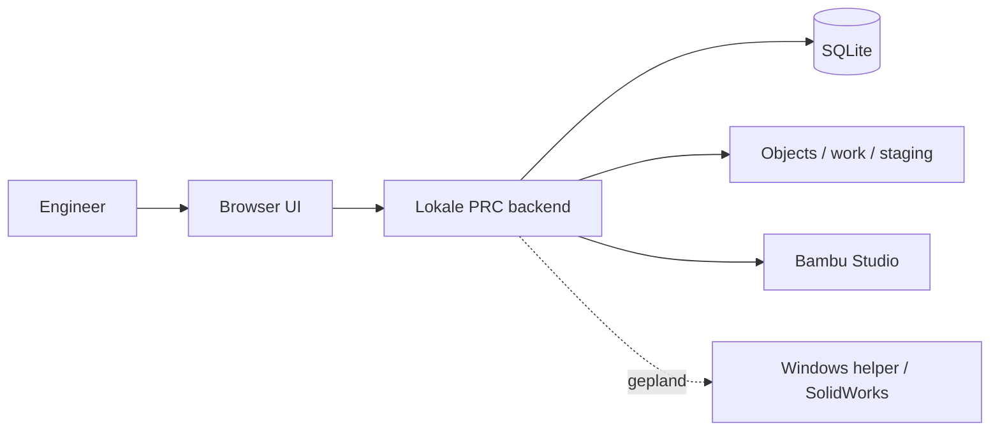

# PrintChill — Softwarearchitectuur

Stand: **MVP 0.3.5**, 2026-11-21. De huidige implementatie staat apart van gepland ontwerp en prototypehistorie. Indeling geïnspireerd op [arc42](https://arc42.org/overview/); besluiten en afwegingen staan in [[DJF]], acceptatie in [[USECASES]] en volgorde in [[ROADMAP]].

## Inhoudsopgave

- [[#Doel en kwaliteitsdoelen]]
- [[#Randvoorwaarden]]
- [[#Context en systeemgrens]]
- [[#Oplossingsstrategie en groeipad]]
- [[#Bouwblokken en modulegrenzen]]
- [[#Runtime en workflows]]
- [[#Deployment en workspace]]
- [[#Datamodel en begrippen]]
- [[#Overkoepelende afspraken]]
- [[#Geplande uitbreidingen]]
- [[#Risicos en open vragen]]
- [[#Implementatiehistorie]]
- [[#Prototypehistorie]]
- [[#Naamgeving applicatie]]

## Doel en kwaliteitsdoelen

PRC verbindt een Part number met exacte CAD-, STL- en 3MF-revisies en het resultaat van printpogingen. Een oude print blijft reproduceerbaar na wijzigingen, verplaatsing van bronmappen en back-upherstel.

| Doel | Ontwerpkeuze / bewijs |
| --- | --- |
| Traceerbaarheid | Onveranderlijke bestandsobjecten en expliciete Part versions; reports verwijzen naar de werkelijk gebruikte versie. |
| Gegevensbehoud | Backendtransacties, inhoudscontrole, conflictcontrole en herstelbare back-ups. |
| Dagelijks gebruik | Werkkopie openen in Bambu, herhaald opslaan, één bevestiging in PRC. |
| Uitbreidbaarheid | UI, domeinopslag, metadata en connectors hebben afzonderlijke verantwoordelijkheden. |

Gerelateerd: [[USECASES]] · [[POC]] · [[PDM_VERSIONING_RESEARCH]] · [[SOLIDWORKS_JSON_POC]].

## Randvoorwaarden

Huidig: Windows x64, één lokale gebruiker en één workspace per backend. Node-runtime wordt meegeleverd; browser-UI, SQLite schema 4 en lokale file storage. Bambu Studio is lokaal geïnstalleerd voor openen en automatisch slicen. Geen teamserver of rechtenmodel. SolidWorks 2026 is doelplatform voor de volgende connector; assemblies vallen buiten de eerste connectorstap. Ontwikkeldocumentatie wordt niet in releasepakketten opgenomen.

## Context en systeemgrens

De engineer gebruikt de browser; de backend beheert alle blijvende registraties. Bambu Studio bewerkt uitsluitend een werkkopie. Native Windows-dialogs selecteren import-, workspace- en back-uppaden. Oorspronkelijke gebruikersmappen zijn importbronnen, geen opslaggarantie.

## Oplossingsstrategie en groeipad

Behoud een modulaire backend binnen één proces. UI rendert en verzamelt invoer; backend valideert en bewaart; SQLite beheert relaties; file storage bewaart bytes. Connectors krijgen begrensde opdrachten voor openen, opslaan en export, zonder eigen Partnummering of databasewrites.

Voor teams: eerst authenticatie, rechten, gelijktijdige wijzigingen en een serveropslag-interface ontwerpen; daarna SQLite desgewenst vervangen door een serverdatabase en objectopslag achter dezelfde domeinacties plaatsen. Een centrale server kan een lokale CAD-app niet rechtstreeks bedienen: daarvoor blijft een lokale agent nodig. Dit groeipad is gepland, geen huidige ondersteuning voor gedeelde netwerkmappen of cloudsync.

## Bouwblokken en modulegrenzen

| Laag | Huidige modules | Verantwoordelijkheid |
| --- | --- | --- |
| Frontend | `app.js`, `screens.js`, `library.js`, `reports.js`, `import-form.js` | Navigatie, invoer, preview en concepten. Geen directe database- of objectwrites. |
| Viewer / metadata | Viewerbundle, `metadata.mjs`, `estimate.mjs` | STL-presentatie, 3MF-extractie en herkenbare schattingen. |
| Backend / OS | `server.mjs` | Lokale API, origin/tokencontrole, Windows-dialogs, starten Bambu en achtergrondberekening. |
| Domein / database | `store.mjs`, `merge.mjs` | Part versions, reports, relaties, transacties, back-up en herstel. |
| Tijdelijke import | `uploads.mjs` | Begrensde uploads met workspace-/rolcontrole en opruiming. |
| Bestandsopslag | `objects/`, `work/`, `staging/` | Onveranderlijke registraties, bewerkbare kopieën en tijdelijke invoer. |

Bestaande code is nog geen verzameling losse services. Splits OS-connectors en domeinacties verder wanneer SolidWorks wordt gebouwd; vermijd een tweede revisie-algoritme naast `store.mjs`.

## Runtime en workflows

| Workflow | Volgorde en garantie |
| --- | --- |
| Eerste registratie | Partnummer aanmaken → CAD/STL/3MF afzonderlijk kiezen of slepen → valideren/capturen → versie 001 transactioneel registreren. STL-only is toegestaan. |
| Bambu bewerken | Exacte 3MF → werkkopie → native Save → detectie → expliciete bevestiging in PRC → volgende Part version. Historie blijft intact. |
| Related objects wijzigen | Basisversie controleren → alleen gewijzigde rollen vastleggen → één nieuwe versie; identieke bytes maken geen versie. |
| Print Report | Exacte versie kiezen → bewijs, metingen en gekozen parameters invullen → expliciete Save. Edit behoudt report-ID en printdatum en controleert conflicten. |
| Back-up/herstel | Objecten en database controleren → preview → annuleren, merge of apart openen. Bestaande gegevens alleen vervangen na bevestiging. |

SolidWorks volgt later dezelfde registratiegrens; zie [[SOLIDWORKS_INTEGRATION_PLAN]]. De huidige Bambu-jobstructuur is uitsluitend 3MF en moet daarvoor rolbewust worden uitgebreid.

## Deployment en workspace

F5 start de lokale stack; distributie gebruikt het versiegebonden Windows x64-pakket met `start.cmd` en gebundelde Node-runtime. Backend bindt op `127.0.0.1:47831` (ontwikkeloverride via `PRC_PORT`). Applicatiebestanden en gebruikersdata staan apart. Origincontrole en een processpecifiek token beschermen muterende browseracties. Dit is geen netwerk-authenticatiemodel.

**Workspace (huidig).** Bij eerste start biedt PRC een lokale map aan, bijvoorbeeld `Documenten\PRC` als Documenten lokaal staat. In Settings kiest de gebruiker **Nieuwe workspace** (lege map) of **Bestaande workspace openen** (herkenbare PRC-database). PRC controleert schrijfrechten en onthoudt het pad per Windows-gebruiker, buiten de workspace. Binnen de workspace zijn alle opslagpaden relatief. Ontbreekt de map na een verhuizing, dan vraagt PRC de bestaande workspace aan te wijzen. Voor de MVP gebruiken we een lokale schijf buiten synchronisatie- en netwerkmappen.

| Onderdeel | Inhoud |
| --- | --- |
| `workspace.sqlite` | Workspace-ID, schemaversie, Parts, revisies, rapporten en werkkopies met hun basisversie |
| `objects/` | Onveranderlijke bestandsinhoud onder een interne sleutel; oorspronkelijke naam en extensie staan in de database |
| `work/<sessie-id>/` | Bewerkbare 3MF met herkenbare naam; PRC volgt het gekozen bestand en vangt vervangen van dat bestand op |
| `staging/` | Tijdelijke invoer voor controle en publicatie; bij herstart controleert PRC achtergebleven bestanden |

Een back-up gaat naar een apart gekozen bestemming buiten de workspace. De MVP-back-up omvat geregistreerde revisies en rapporten. De export meldt openstaande werkkopieën zodat de gebruiker gewenste wijzigingen eerst kan bevestigen. Apart herstel maakt bij een gevulde doelmap een nieuwe submap; merge vervangt uitsluitend de vooraf getoonde overlappende Part numbers. Beide controleren de geregistreerde objecten.

Back-up, restore en merge: [[#Back-up Mechanism]]. Leesgebruik en writes blijven bij de backend; meerdere app-processen op dezelfde workspace zijn geen ondersteunde teamoplossing.

## Datamodel en begrippen

### Datamodel voor gebruikers

Conceptueel domeinmodel; het huidige fysieke MVP-schema is versie 4. De afbeelding is de eerdere gebruikersrendering en is achterhaald voor Part versions en Print Reports; onderstaande definities zijn leidend.

### Definities

| Begrip              | Definitie                                                                                                                                                                           | Voorbeeld                                                               |
| ------------------- | ----------------------------------------------------------------------------------------------------------------------------------------------------------------------------------- | ----------------------------------------------------------------------- |
| **Part**            | Het logische onderdeel met een vaste identiteit, onafhankelijk van bestandsnamen en versies. ‘Object’ is een technische verzamelterm; geen aparte gebruikersentiteit                | Makita blower wall mount, partnummer 7382-4916                          |
| **Document**        | Een beheerd bestand met eigen identiteit en versiehistorie. Een document kan verschillende vastgelegde versies hebben                                                               | SolidWorks-part, STL-document of 3MF-printproject                       |
| **Documentrevisie** | Een vastgelegde, onveranderlijke toestand van één document, inclusief inhoud en bijbehorende metadata                                                                               | CAD C, STL C of 3MF G                                                   |
| **Part version**    | Onveranderlijke geregistreerde toestand van een PRC Part met exacte CAD-, STL- en 3MF-revisies. Nummer start bij 001 en telt op bij bestandswijzigingen                             | Part 7382-4916, version 003: CAD C, STL C, 3MF G                        |
| **Snapshot**        | Latere baseliningfunctionaliteit; geen extra verplichte laag voor de dagelijkse Part-workflow. Scope nog uit te werken, een snapshot kan meerdere parts bevatten.                   | S-001 bevat CAD C, STL C en 3MF G, git link, print reports, attachments |
| **Print Report**    | Verslag van één daadwerkelijke printpoging, gekoppeld aan de gebruikte Part version; bevat printer, materiaal, beschikbare instellingen, resultaat, metingen, foto's en opmerkingen | PR-001 beschrijft een print van Part version 003                        |
| **Status**          | Gepland beleid met afzonderlijke design state en maturity; zie Part Status and maturity. Nog niet volledig in de runtime geïmplementeerd                             | Geen impliciete statusovergang door een save of snapshot                |
| **Tag**             | Herbruikbaar zoeklabel op Parts; vergelijking op naam is hoofdletterongevoelig                                                                                                      | `#roboticarm`                                                           |
| **Collections**     | Vlakke benoemde verzameling; many-to-many op Part number, zonder verhoging van Part version   | Parts voor een robotarm of keuken organizers                            |

Documentrevisies gebruiken letters; Part versions gebruiken minimaal drie cijfers vanaf 001. Interne IDs identificeren documenten, revisies en Part versions onafhankelijk van labels. Doelbeleid na 999: nieuw Part number; afdwinging en gebruikersflow nog valideren.

### Relaties

| Relatie                              | Van → naar                                                                                        | Omgekeerd zichtbaar als    |
| ------------------------------------ | ------------------------------------------------------------------------------------------------- | -------------------------- |
| **Hoort bij**                        | Document → Part                                                                                   | Documenten                 |
| **Heeft versie**                     | Document → Versie                                                                                 | Versie van                 |
| **Geëxporteerd uit**                 | STL-versie → bewezen CAD-revisie met configuratie; bij legacy-import mag de bron onbekend zijn                              | Exports                    |
| **Gebruikt**                         | 3MF-versie → één of meerdere STL-/modelversies; CAD-assemblyversie → onderdeelversies waar bekend | Waar gebruikt / Where used |
| **Legt vast**                        | Snapshot → specifieke documentversies en hun bronrelaties                                         | Opgenomen in snapshots     |
| **Geprint met**                      | Print Report → exacte Part version                                                                | Print Reports              |
| **Bevat**                            | Part version → exacte documentrevisies                                                            | Opgenomen in Part versions |
| **Ondersteunt**                      | Attachment / Git-verwijzing → Part version                                                        | Attachments                |
| **Afgeleid van**                     | Part → ander Part                                                                                 | Afgeleide Parts            |
| **Heeft tag**                        | Part → Tag                                                                                        | Parts met deze tag         |
| Related objects (desribing relation) | part --> object (CAD,3MF ,STL)                                                                    | Related to                 |
| Related objects (reference)          | part -->  documents / wiki pages, git link,print report, collections, snapshots                   | Related to                 |

Een standaard CAD- of STL-document hoort bij het betreffende Part. Een 3MF-project en een snapshot kunnen meerdere Parts omvatten; de documentassociaties en bronrelaties mogen daarom niet tot één Part worden beperkt. Onderdeel-/plaatcontext blijft bewaard waar beschikbaar.

### Regels

- Een Part krijgt meteen een uniek nummer; versie 001 ontstaat bij de eerste bevestigde bestandscombinatie.
- CAD, STL en 3MF hebben in de huidige MVP onafhankelijke revisietellers. Het gewenste gelijklopen van CAD/STL bij bewezen export is connectorbeleid, geen bewijs uit gelijke letters.
- Elke Part version legt exacte revisies vast. Alleen bevestigde inhoudswijzigingen verhogen de versie; meerdere gewijzigde rollen vormen samen één versie.
- Print Reports, collecties, tags en Git-links verhogen geen technische versie. Een report verwijst blijvend naar één Part version.
- Handmatig koppelen bewijst samenhang van de combinatie, niet automatisch de CAD-bron van de STL.
- Bestandsnaam, timestamp en gekopieerde custom properties bewijzen geen identiteit; inhoudscontrole en expliciete context blijven nodig.
- Snapshots zijn latere baselines met exacte versies, nooit dynamische latest-verwijzingen.
- De metadata-POC gebruikt `source.active_configuration`; `export_id` identificeert een extractie, geen Part of revisie.

## Overkoepelende afspraken

### UI-uitgangspunten

Uit UC-006 t/m UC-009: circa 20% zijbalk met zoeken, filters, collecties en projecten; de overige ruimte toont Part-kaarten. Een kaart toont identiteit, beschikbare versie-/printcontext en tags. Hover/focus kan details tonen; dezelfde functies zijn via klik/toetsenbord bereikbaar.

De 3D-viewer toont welke STL-versie wordt bekeken, met een optionele bounding box en eenheden. Ontbrekende printgegevens blijven onbekend; tijd, materiaal en laatste print krijgen een expliciete 3MF-/Print Report-context binnen de gekozen Part version. Een Part toont zijn expliciete numerieke Part version met de daarin vastgelegde bestandsrevisies.

De runtime gebruikt v5: gelijke kaarten, History met klikbare afleidingen, grotere viewer naast details, Settings voor back-up en herstel. Wiki/SolidWorks-knoppen tonen tot implementatie hun geplande status.

### Part Details

De geselecteerde Part version bepaalt alle bestands- en printcontext. Related Objects toont exacte revisies; details tonen Partmetadata en beschikbare 3MF-instellingen. Materiaaltoewijzing, projectpreset, objectoverrides en werkelijk printverbruik zijn verschillende scopes. Ontbrekende waarden blijven onbekend.

### Back-up Mechanism

Database én alle geregistreerde objecten gaan mee; reportafbeeldingen en collectierelaties staan in SQLite schema 4. Voor migraties wordt een volledige back-up gemaakt. Werkkopieën en staging zijn geen geregistreerde revisies; open werk wordt vooraf gemeld. De preview toont naam, datum indien beschikbaar, grootte, Part-aantal en te vervangen nummers.

#### Backup restore merge conflicts

Merge behoudt unieke lokale Parts, vervangt overlappende Parts met de back-upinhoud en voegt nieuwe toe. De gebruiker ziet conflictnummers en bevestigt vooraf. Gelijke collectienamen worden samengevoegd; niet vervangen Parts behouden hun lidmaatschappen. Apart herstel gebruikt een nieuwe submap als de gekozen doelmap gevuld is. Beschadigde of onvolledige bron wordt geweigerd.

### Tijdnotatie in applicatie

Gewenste gebruikersnotatie: DD/MM/YYYY HH:mm, 24-uurs. Interne opslag bewaart tijdstippen; alle schermen en exports moeten nog op consistente lokale weergave worden gecontroleerd.

### Consolidatie filament en tijdindicatie

Huidig: extractie uit de exacte geregistreerde 3MF, automatisch lokaal slicen met Bambu waar beschikbaar en een herkenbare geometrie-/parametergebaseerde schatting als fallback. Een schatting is geen gemeten tijd of volledige Bambu-voorspelling. Bron en berekenstatus blijven zichtbaar; materiaalconfiguratie is geen live AMS-inventaris. Het eerdere prototypebeleid “alleen Slice required” is hiermee achterhaald. Onderzoek: [[3MF_PRINT_DETAILS_RESEARCH]].

## Geplande uitbreidingen

### SolidWorks connector

Plan voor openen, registreren en wijzigen: [[SOLIDWORKS_INTEGRATION_PLAN]]. PRC is leidend voor identiteit, Part version en commit; de macro schrijft alleen werkkopieën. Doelplatform SolidWorks 2026, eerste scope zelfstandige mono-parts.

### Part-wiki met BlockNote en lokale zoekindex

**Status:** gekozen richting voor [[USECASES#UC-020 Part-wiki schrijven, aan versies koppelen en terugvinden|UC-020]]; nog niet geïmplementeerd. MVP 0.3.5 behoudt de Wiki-placeholder. Een volgende schemaversie wordt pas bij implementatie toegekend, met vooraf een volledige migratieback-up.

#### Editor en modulegrens

BlockNote levert de editor binnen de PRC Wiki-tab; Docmost/Confluence is de referentie voor leesweergave, paginaboom en schrijfervaring. Gebruik een afgebakend React-onderdeel met de kant-en-klare BlockNote-bediening, lokaal gebundeld met de bestaande bouwstap. De overige PRC-UI hoeft daarvoor niet naar React. Bij openen/sluiten worden editor, concept en eventhandlers expliciet geladen/vrijgegeven. Geen externe wiki-service, cloudaccount of CDN nodig. De basispakketten zijn MPL-2.0; XL-pakketten hebben een andere licentie en zijn geen uitgangspunt. Pakketversies en benodigde afhankelijkheden worden bij implementatie vastgezet. [BlockNote-integratie](https://www.blocknotejs.org/docs/getting-started/vanilla-js), [licenties](https://github.com/TypeCellOS/BlockNote#license-).

Alleen de PRC-backend schrijft naar SQLite en bestandsopslag. Wiki-acties voor pagina's, save, revisieherstel, prullenbak, bijlagen en zoeken lopen via de bestaande lokale API met dezelfde origin-/tokencontrole. De backend valideert documentstructuur, blok-ID's, limieten en verwijzingen; documentinhoud is geen uitvoerbare HTML. Afbeeldingen worden gecontroleerd en als beheerde bestanden aangeboden. Een wiki-module is verantwoordelijk voor opslag/relaties; een zoekmodule voor de queryinterpretatie en index.

#### Eigendom, revisies en versieverwijzingen

De pagina hoort blijvend bij een Part number, ook als nog geen Part version bestaat. Een ouderpagina moet tot hetzelfde Part behoren; verplaatsingen mogen geen cycli maken. Paginarevisies zijn onafhankelijk van CAD/STL/3MF en verhogen geen Part version. De technische History blijft bestaan naast het handmatig geschreven designlogboek.

Conceptueel model; tabelnamen zijn een voorstel, geen huidige database-interface:

| Object | Voorgestelde gegevens en verantwoordelijkheid |
| --- | --- |
| `wiki_pages` | Stabiele pagina-ID, eigenaar-Part, ouderpagina, volgorde, actuele revisie en prullenbakstatus |
| `wiki_revisions` | Pagina-ID + eigen revisienummer, titel, BlockNote-JSON met inhoudsschemaversie, wijzigingsdatum; na save onveranderlijk |
| `wiki_version_refs` | Paginarevisie + optionele blok-ID → exacte `(part, v)`; zonder blok-ID geldt de verwijzing voor de pagina |
| `wiki_assets` | Paginarevisie → objectkey, bestandsnaam en type; afbeeldingen/bijlagen in bestaande `objects/` |
| `wiki_drafts` | Afzonderlijk concept met basisrevisie en opslagstatus; niet opgenomen in de standaardzoekindex |
| `wiki_search` | Afgeleide full-textindex met Part-, pagina-, revisie- en blok/sectie-ID voor navigatie |

Voor secties gebruiken we stabiele BlockNote-blok-ID's of een expliciet sectieblok met eigen ID; geen koptekst, positie of regelnummer als sleutel. Hernoemen en verplaatsen behouden die ID. Dupliceren levert nieuwe ID's op. Een sectie heeft een afgebakende blok-/kindgroep; verplaatsen van losse tekst maakt die tekst niet stilzwijgend versiegebonden. [BlockNote-blokidentiteit](https://www.blocknotejs.org/docs/foundations/document-structure).

Een pagina, subpagina of sectie kan expliciet naar meerdere bestaande versies van hetzelfde Part verwijzen. Een badge in de kantlijn opent de exacte versie; die versie biedt terugverwijzingen naar de wiki. Zonder koppeling is inhoud algemeen. Er is geen impliciete overerving naar subpagina's of automatisch naar nieuwe Part versions. Koppelingen worden samen met de inhoud gereviseerd. Een verwijderd doel krijgt een zichtbare ontbrekende-verwijzingstatus; de app kiest nooit vanzelf latest. De pagina blijft bewerkbaar: een versieverwijzing bevriest de tekst niet. Later kan een Print Report een exacte paginarevisie en blok-ID vastleggen als instructiebewijs.

Save gebruikt de bekende basisrevisie als conflictcontrole, ook voor twee lokale vensters. Een verouderde basis overschrijft niets; het eigen concept blijft beschikbaar. Een inhoudelijke save maakt een nieuwe paginarevisie. Herstellen van een eerdere revisie maakt opnieuw een revisie en wist geen historie. Conceptopslag staat apart van de expliciete Save en krijgt een eigen zichtbare status; backendfouten mogen niet als succesvolle opslag verschijnen.

#### Zoeken vanuit de linkerzijbalk

De bestaande zoekbalk wordt standaard uitgebreid met paginatitels, sectiekoppen en leesbare wiki-inhoud, naast Partmetadata. De centrale zoekservice combineert deze tekstmatches met de regels van UC-008: vrije termen matchen metadata **of** wiki, + vereist alle criteria op hetzelfde Part, # is uitsluitend een tagfilter. Termen mogen over meerdere pagina's van dat Part voorkomen. Collectie-, bestandstype-, projectparameter- en Print Report-filters blijven gelden; een materiaalnaam in lopende tekst vervangt geen expliciet materiaalfilter. Combineren gebeurt vóór paginering; de bibliotheek dedupliceert op Part number.

Een wiki-treffer bevat Part number, pagina-ID/titel, blok/sectie-ID, tekstfragment en eventuele expliciete versiecontext. De UI maakt zichtbaar waarom het Part matcht en biedt directe navigatie naar de pagina/sectie. Een gewone Part-treffer blijft Part details openen. Bewaarde zoekopdrachten blijven criteria opslaan en evalueren de actuele wiki opnieuw; geen vaste lijst gevonden pagina's.

**Indexkeuze: SQLite FTS5 binnen `workspace.sqlite`.** Geen aparte zoekserver nodig voor de lokale MVP. Extraheer op de backend leesbare tekst uit gevalideerde BlockNote-JSON, inclusief geneste blokken, tabellen en bijschriften; indexeer geen ruwe JSON, opmaakcodes of bestandsbytes. Indexrecords hebben de juiste blok/sectiecontext voor snippets. Een paginatitel krijgt meer gewicht dan lopende tekst. Begin met Unicode-woordtokenisatie (`unicode61`) en gecontroleerde prefixzoeking; dat belooft geen willekeurige substring-, typo- of taalafhankelijke zoekfunctie. De bestaande naamzoeking kan haar huidige gedrag behouden. Controleer bij implementatie FTS5-ondersteuning in de gebundelde Node/SQLite-runtime. [SQLite FTS5](https://www.sqlite.org/fts5.html).

De bron is de actuele opgeslagen paginarevisie. Concepten, prullenbak en historische revisies vallen buiten standaardzoeken; OCR en zoeken in PDF-/bijlagebytes volgen later. Bij save, hernoemen, prullenbak/herstel en revisieherstel worden brongegevens en bijbehorende indexrecords in één SQLite-transactie bijgewerkt. De index is afgeleid en volledig herbouwbaar; bij migratie, ongeldigheid of herstel kan PRC hem opnieuw opbouwen uit de bronrevisies. Een tijdelijke onvolledige index krijgt een zichtbare melding. Gebruikersquery's worden volgens UC-008 geparseerd en als gequote tokens met gebonden parameters naar FTS5 vertaald; geen rechtstreekse SQL/FTS-expressies uit de zoekbalk. Snippets worden veilig als tekst getoond. Een later rechtenmodel filtert vóór snippets en aantallen worden teruggegeven.

#### Back-up, herstel en groeipad

De bestaande back-up wordt uitgebreid met alle wiki-pagina's, paginarevisies, verwijzingen, opgeslagen concepten/prullenbak en alle gerefereerde wiki-bestandsobjecten. Oude paginarevisies houden hun bijlagen beschikbaar. Een databasekopie alleen volstaat niet: de objectinventaris voor back-up moet ook `wiki_assets` volgen. De FTS-index mag worden meegekopieerd, maar is geen herstelbron en wordt na restore/merge gecontroleerd of herbouwd.

De bestaande merge-regel blijft leidend: overlappende Part numbers nemen de volledige wiki uit de back-up over, inclusief revisies en relaties; andere lokale Parts behouden hun wiki. Wis daarbij oude indexrecords en voeg actuele toe, zonder pagina's op titel samen te voegen. Stabiele pagina-ID's moeten bij verschillende Parts op botsingen worden gecontroleerd; een onverenigbare botsing breekt de transactie af. Een oude back-up zonder wiki bevat voor vervangen Parts ook geen wiki: preview moet het verlies van aanwezige lokale wiki-pagina's vóór bevestiging expliciet melden. Herstel kan via back-upbrondata volledig worden herhaald, inclusief afbeeldingen en versieverwijzingen.

Eerste scope blijft één lokale gebruiker. Zoekindex en editor zijn vervangbare modules achter de backend; voor latere teams kunnen opslag en zoekservice worden uitgebreid zonder de Part-/pagina-identiteiten te veranderen. Realtime samenwerking, comments en formele publicatie zijn afzonderlijke uitbreidingen. Acceptatievolumes, zoekreactietijd, uploadgrenzen en concept-/prullenbakretentie worden vóór implementatie vastgesteld in UC-020; hier worden geen onbewezen prestaties of huidige functionaliteit geclaimd.

### Wiki-formules en PDF-export

UC-020 krijgt na de basiswiki inline- en blokformules met opgeslagen LaTeX-bron. De officiële [BlockNote-mathblokken](https://www.blocknotejs.org/docs/features/blocks/math) vormen de eerste te toetsen optie; render lokaal zonder uitvoerbare gebruikerscode. Ondersteunde macro's, foutweergave, opslag en zoektekst krijgen een compatibiliteitsproef.

UC-022 beschrijft PDF-export van een opgeslagen wikirevisie of Print Report. Begin met een gedeelde printweergave en browser Save as PDF; directe export kan later achter dezelfde exportinterface. De officiële [BlockNote PDF-exporter](https://www.blocknotejs.org/docs/features/export/pdf) is een XL-pakket met copyleft-/commerciële licentieopties; keuze en pakketversie eerst vastleggen in DJF. Geen impliciete XL-afhankelijkheid toevoegen.

### Meten en analyse

Gepland: UC-003 uitbreiden met punt-/vlakselectie in de STL-viewer en een meetreferentie naar de exacte STL-revisie. Bewaar nominale modelmaat en werkelijke meetwaarde afzonderlijk; STL bevat geen ontwerpsemantiek voor automatische gat-/featureherkenning. Mesh-eenheid, toleranties en camera-onafhankelijke selectie eerst beproeven. PDF gebruikt UC-022.

UC-023: advies uit reportbewijs en instellingen, met bronverwijzingen en onzekerheid. Begin met expliciete selectie; geen automatische settingswijziging. Provideradapter en gegevensselectie houden AI buiten versiebeheer en opslagkern.

### Part Status and maturity

**Doelbeleid, nog niet volledig geïmplementeerd.**

Een part loopt verschillende life cycles door op gebied van design, maar ook op gebied van productie.

Design state:
	- Draft
	- Abandoned
	- Released
	- Obsolete
Maturity of print:
	- Proof of concept
	- Prototype
	- Mature
	- End of life

Design state zegt ie over de status van het design van het part. de maturity zegt iets over het niveau van het part in zijn toepassing.

#### Design States
##### Draft
Dit is een eerst stap van een design om wat te proberen, het is nog work in progress.

##### Abandoned
veel ontwerpen stranden al snel omdat het toch niet wat is geworden, je toch op andere ideeen bent gekomen. Abandoned geeft aan zoals de naam al zegt; men heeft het design gewoon verlaten. het is er nog wel maar er wordt niet meer naar om gekeken.
alleen parts vanuit draft kunnen naar deze status toe.

##### Released
het design is af en is uit de trial en error fase, er staat een stabiel design.
bij released kun je niet zo maar een nieuwe wijziging doen, PRC vraagt expliciet of je het zeker weet aangezien het released is.

##### Obsolete
er is wat beters bedacht, of het is niet meer nodig , overbodig geworden, you name it. het design eindigt hier. je kunt nu niets meer met het part. als je wilt wijzigen zul je nieuw part number uit moeten trekken.

#### Maturity states

##### Proof of concept
De eerst printjes om eens wat te proberen, pas testjes etc. het begin...

##### Prototype
Een van de eerste volwaardige prints nadat je wat proof of concepts prints hebt gemaakt.
Je design en 3MF file hebben wat eerste iteraties door gemaakt in de PoC fase.

##### Mature
Het design is stabiel nadat je de eerste feedback ontvangen hebt, je hebt de print parameters en settings goed onder de knie.
En het part is in grote getalen probleemloos te maken.

##### End of Life
Het part wordt niet meer gebruikt om verschillende redenen, beter andere ideeen hebben het overbodig gemaakt. de vraag is er niet meer. De interfacende onderdelen bestaan niet meer of zijn niet meer te koop etc etc.
bij end of life kan het part niet meer gewijzigd worden. wil je er toch wat mee dan zul je een kopie moeten maken onder een nieuwe nummer.

#### State mapping

bij het creeren van een part begin je altijd met Draft en Proof of concept

From to relaties. je kun niet terug.

| From / to -> | Draft | Abandoned | Released | Obsolete |
| ------------ | ----- | --------- | -------- | -------- |
| Draft        | -     | yes       | yes      | No       |
| Abandoned    | No    | -         | No       | No       |
| Released     | No    | No        | -        | Yes      |
| Obsolete     | No    | No        | No       | -        |

mapping design states op maturity states

|                  | Draft | Abandoned | Released | Obsolete |
| ---------------- | :---: | :-------: | :------: | :------: |
| Proof of concept |   x   |           |          |          |
| Prototype        |   x   |     x     |          |          |
| Mature           |       |           |    x     |    x     |
| End of Life      |       |           |    x     |    x     |

### Part Types

**Later, na mono-partconnector.**

PRC part kan een mono deel zijn maar ook een samenstelling.
er zal een tab zijn binnen de part tab met "Part structure"
hierin zullen alle child componentne zichtbaar zijn die in de solidworks file zitten.
met part nummer en name, revision. vanuit deze child components kun je dan where met "where used" verticaal door de structuur navigeren.
bij een mono part is er geen structure en deze tab dus leeg.

side note: het is nu erg op solidworks ge-orienteerd, maar in de toekomst moeten ook om kunnen gaan met Fusion 360 en freeCad

## Risicos en open vragen

| Onderwerp | Nog te besluiten of te bewijzen |
| --- | --- |
| CAD/STL-revisies | Gewenst gelijklopende letters bij bewezen export versus bestaande onafhankelijke MVP-tellers; migratiebeleid vóór implementatie kiezen. |
| SolidWorks | Macro compileren en end-to-end testen op 2026 SP0; save/exportfouten, configuraties en reeds geopende documenten. |
| Bronherkenning | Naam of gelijke letters bewijzen geen STL/CAD-relatie. Vastleggen via exportmanifest en hashes. |
| Versiegrenzen / nummering | 999-grens, custom nummering en bestaande CAD-labels; gebruikersflow en afdwinging toetsen. |
| Lifecycle / assemblies | Doelbeleid en volledige native referenties zijn geen bewezen MVP-functies. |
| Wiki | Acceptatievolumes, retentie, runtime-FTS5 en formule-/exportlicenties vaststellen vóór bouwen. |
| Teamgebruik | Identiteit, rechten, concurrency, centrale opslag en lokale CAD-agent ontwerpen vóór netwerkdeployment. |

Bestaande implementatieacceptatie: [MVP-testplan](../MVP/TESTPLAN.md). De eerdere verwijzing naar een ontbrekende ISS-001-sectie is vervangen door expliciete risico's hierboven.

## Implementatiehistorie

### MVP 0.3.5 — expliciet bewaren en reports bewerken

Reportvelden onderscheppen Enter vóór impliciete form-submit: de parameterkiezer gebruikt Enter voor selectie/toevoegen, Notes voor nieuwe regels en andere tekstvelden voor invoer zonder Save. Een knop kan nog expliciet met Enter worden geactiveerd. Submit zonder expliciete Save-submitter wordt geblokkeerd; listeners leven alleen zolang het report openstaat.

Edit gebruikt hetzelfde reportformulier met de opgeslagen bronversie, afbeeldingen, metingen, parameterwaarden en suggesties. Opgeslagen parameterwaarden krijgen bij laden voorrang boven opnieuw uitgelezen metadata. Editconcepten hebben een eigen sleutel per workspace en report-ID. De backend valideert met dezelfde regels als bij aanmaak en werkt de bestaande SQL-rij transactioneel bij; ID, oorspronkelijke printdatum en Part/version-relatie blijven ongewijzigd. Een SHA-256-token over het oorspronkelijke report controleert gelijktijdige edits zonder grote afbeeldingen tweemaal te versturen. Conflicten behouden het concept en bieden herladen; identieke herhaalde save maakt geen extra report. Er is geen databasemigratie of report-revisiehistorie toegevoegd.

### MVP 0.3.4 — selectie per rol en gerichte printfeedback

Dezelfde bestandsform-module bedient eerste registratie en UC-021. CAD, STL en 3MF hebben elk een eigen selectie, Windows-bestandskiezer en dropzone. Een volgende selectie wist andere rollen niet. Browserdrops worden binair en begrensd (256 MB per bestand) via een origin-/token-beveiligde uploadroute naar `staging/upload-<uuid>/` geschreven. De backend bewaart rol en workspace bij het tijdelijke upload-ID; de client hoeft geen lokaal absoluut pad uit een browser-File te halen. Controle en capture gebruiken daarna de bestaande beheerde objectopslag. Bevestigen ruimt tijdelijke uploads op; annuleren probeert ze te verwijderen, onderbroken uploads worden teruggedraaid en achtergebleven uploads na 24 uur opgeruimd. Tijdelijke uploads horen niet bij een back-up.

Edit related objects levert een nieuwe Part version vanuit een gecontroleerde basisversie. Bestaande rollen blijven behouden, nieuwe rollen beginnen bij revisie A en veranderde rollen tellen één letter op. Identieke bytes leveren geen nieuwe versie. De commit controleert opnieuw de basisversie; ongeldige bestanden of conflicten laten alle historische registraties intact. Bambu-werkkopieën houden hun oorspronkelijke basis en volgen later de bestaande conflictcontrole. Geen schemamigratie nodig.

Een nieuw Print Report heeft geen standaardparameters. De engineer voegt beschikbare, ingevulde 3MF-parameters gericht toe. Zoeken gebruikt interne sleutels én herkenbare namen; `support_top_z_distance` wordt Support Z offset met eenheid mm. De oorspronkelijke waarde blijft in `details.parameters`; gebruikersvoorstellen staan afzonderlijk in `details.suggestions`, gekoppeld aan dezelfde sleutel. Suggesties schrijven nooit naar de 3MF of Part version. Conceptopslag, reportweergave en databaseback-up bewaren beide. Oude opgeslagen reports blijven leesbaar; oude concepten krijgen hun voorheen automatisch gekozen standaardparameters niet opnieuw opgedrongen.

### MVP 0.3.3 — nominale en gemeten maat

Meetregels krijgen een optioneel tekstveld `nominal` voor de door de gebruiker uit het 3D-model overgenomen nominale waarde. Dit is een afzonderlijk veld naast `position` en de gemeten `value`; geen automatische herkenning van willekeurige CAD-maten. De bestaande JSON-opslag bewaart het veld zonder schemamigratie. Oude reports en concepten zonder dit veld blijven bruikbaar met een lege nominale cel. De vier tabelkolommen en veldhoogten zijn gelijk in invoer en leesweergave; de bovenliggende reportvelden zijn per rij uitgelijnd, zonder herhaalde hulptekst.

### MVP 0.3.2 — reportcontext en metingen

Een gedeelde pure reportmodule bepaalt context en presentatie: printermodel uit de gekozen 3MF-projectinstellingen, materiaal uit de toegewezen/gebruikte filamenten. Alleen bij één eenduidig geconfigureerd materiaal is een fallback toegestaan. De gebruiker kan de daadwerkelijke printer of het materiaal aanpassen; het report bewaart de gekozen waarden als snapshot. Lege/null-parameters worden overgeslagen, ook in oudere reportweergaven; nul en false blijven zichtbaar. Arraywaarden behouden in de weergave de oorspronkelijke slotnummers.

`details.measurements` ondersteunt gestructureerde regels `{id: 'M1', position: 'Hole diameter', value: '19.8 mm'}` met automatische oplopende nummers. De backend valideert unieke M-nummers en ingevulde tekstvelden; waarden blijven tekst om eenheden en decimale komma's toe te staan. De bestaande JSON-opslag en back-up nemen de regels mee zonder schemamigratie. Oude reports met een string blijven leesbaar; bij een oud concept blijven de oorspronkelijke notities apart bewaard naast nieuwe meetregels. Technische Part versions veranderen niet.

### MVP 0.3.1 — screenshots in Print Reports

Het report biedt bovenaan een plakvak met preview, teller en lokale foutmeldingen. Een documentbrede paste-listener in capture-fase verwerkt zowel `clipboardData.items` als `.files`, uitsluitend zolang dit report openstaat. Gewone tekst behoudt standaardgedrag. Paste from clipboard leest op expliciete klik de ondersteunde afbeeldingsrepresentatie via de browser-Clipboard API; geweigerde toegang wordt zichtbaar gemeld. Sluiten ruimt de listener op via AbortController. Afbeeldingen worden in volgorde gevalideerd en toegevoegd; Save wacht op de importwachtrij. Bestaande reportopslag, concepten en limieten blijven leidend; geen databasemigratie. De Chrome-regressie gebruikt een echte PNG op het klembord en Ctrl+V, plus items-only- en foutscenario's.

### MVP 0.3.0 — UI en collecties

- De goedgekeurde v5-indeling vormt de runtime-UI: circa 20% zijbalk, gelijke kaarten, Part details naast de STL-viewer, tabbladen voor platen, History en reports. Back-up en herstel staan onder Settings.
- Collecties zijn vlakke, benoemde verzamelingen met een many-to-many-relatie naar Part numbers. Eén Part kan in meerdere collecties staan. Lidmaatschap is actuele Part-metadata en verhoogt geen Part version. Onder Tags staat **Collected by:**.
- Schema 4 voegt `collections`, `part_collections`, `part_info` en `version_links` toe. Een bestaande workspace krijgt vóór migratie een volledige back-up naast de workspace. Bestandsobjecten en historische revisies blijven behouden.
- Een lege Part krijgt direct een nummer; versie 001 ontstaat pas na registratie van de eerste bestanden. Save as / derive begint bij 001 en bewaart het bronnummer en de bronversie voor de History-vertakking. De bestandsinhoud wordt gedeeld via bestaande onveranderlijke objecten.
- Git-links blijven aan een exacte Part version gekoppeld. Collecties en bronrelaties gaan mee in de databaseback-up. Merge vervangt lidmaatschappen van conflicterende Parts; overige Parts behouden hun indeling. Collecties met dezelfde naam worden samengevoegd zonder onderscheid in hoofdletters.
- SolidWorks-integratie en Wiki blijven roadmapfuncties; de UI claimt hiervoor geen werkende connector of editor.

## Prototypehistorie

Onderstaande notities beschrijven eerdere UI-proeven, niet de huidige runtime. Bij afwijkingen zijn bovenstaande MVP-afspraken leidend.

### HTML UI-prototype

Zie [prototype](../prototype/README.md): visuele bibliotheek, STL-viewer, onafhankelijke documentrevisies, numerieke Part versions, Logbook, versiegebonden attachments en Print Reports. Gegevens blijven in het browsergeheugen; historische versies en relaties zijn demo’s. Geen backend of CAD-/slicerconnector. Volledige UC-acceptatie blijft open.

### UI-feedback — prototype 2

- Part version 001, 002, … bevat vaste referenties naar één of meerdere CAD/STL-documenten en 3MF, elk met eigen letterrevisie. Eén bevestigde wijzigingsactie levert één Part version, ook bij meerdere gewijzigde bestanden.
- Een ongewijzigde inhoud levert geen nieuwe versie op. Detectie van werkelijke bestandswijzigingen blijft apart onderzoek; de UI-proef simuleert registratie, geen file-watcher.
- Print Reports, attachments en Git-verwijzingen verhogen de Part version niet. Ze blijven aan de gekozen historische versie gekoppeld.
- Logbook per Part number toont alle Part versions, gewijzigde bestanden en comments per bestand; geschiedenis wordt niet overschreven. Een versiebol opent de vaste bestandslijst en comments.
- Part number is prominent gelabeld. UI-basistaal is Engels; documentatie mag Nederlands blijven. Kaarten tonen uitsluitend de geselecteerde Part version en haar eigen printcontext.
- Where used: geselecteerde STL-revisie centraal, gebruikers (3MF/assemblies) erboven, concrete CAD-bron eronder, met verbindingslijnen. Onbekende herkomst blijft onbekend.
- Snapshots verdwijnen uit de dagelijkse UI en worden later als baseliningfunctie uitgewerkt (UC-010).
- Git-koppeling bewaart repository-URL en bij voorkeur commit-SHA; een veranderlijke branch/tag is geen vast softwareversiebewijs.

### Prototype v4 — samples en UI-review

- Read-only samplecatalogus: 67 bestanden, hashes en expliciete naam-/metadata-associaties. Zie [[SAMPLE_ANALYSIS]]. De 36 groepen zijn importgroepen, geen automatisch bewezen CAD-identiteiten.
- Echte A/B-STL’s krijgen eigen geometry-assets; de previewcache is per bestand, niet per Part. Gesimuleerde revisies houden een zichtbaar samplelabel en geen fictieve nieuwe bronhash.
- 3MF-object-/volumerecords, plaatbeelden en filamenttoewijzingen vormen projectcompositie. Native CAD-assemblykinderen zijn een andere relatie en worden uitsluitend via expliciete extractie/manifest getoond.
- IndexedDB bewaart lokaal workspace, concepts, reports en attachments; export/import van JSON-backups maakt overdracht mogelijk. Geen serveropslag, accounts, rechtenmodel of cloudsync.
- Tabel met sortering/kolommen, versievergelijking, compacte inspectie, deelbare versiehash, toetsenbordtabs, benoemde dialogs en hover-/focustooltips verwerken [[UI_DESIGN_REVIEW]].
- Design state en maturity zijn Part-level metadata. Het bestaande mappingbeleid blijft leidend; statuswijzigingen verhogen geen Part version. Released-bestandswijzigingen vragen bevestiging; Obsolete/End of life blokkeren ze en bieden kopiëren.
- Assemblymanifestimport verrijkt een bestaande Part version met uitleesbewijs, zonder wijziging van bronbestanden. Bestandsnaammatch zonder bronhash wordt zichtbaar onbevestigd gehouden.

## Naamgeving applicatie

**Productonderzoek; geen architectuurbesluit of bevestigde merkcontrole.** Bestaande gebruikersnotities hieronder blijven behouden.

Samana ontleent zijn betekenis aan de gereconstrueerde Germaanse vorm *samana*, die ‘samen’ of ‘gezamenlijk’ betekent en verwant is aan het Oudnoordse *saman*. Als bedrijfsnaam staat het voor het samenbrengen van ideeën, mensen en techniek: van een eerste klantvraag naar een doordacht ontwerp en een tastbaar product. Daarmee past Samana bij 3D-printen, CAD-ontwerp en maatwerk, terwijl de naam ook ruimte biedt voor toekomstige engineeringactiviteiten. De vloeiende, internationaal klinkende naam heeft een rustigere en professionelere uitstraling dan Printchill en legt de nadruk op samenwerking en oplossingen. Samana wordt al door andere organisaties gebruikt; de geschiktheid als merknaam voor jouw activiteiten moet daarom nog worden vastgesteld.

shortlist; nog nader te bepalen wat te doen. printchill bekt lekker maar ligt te dicht bij Windchill. gaat gedoe opleveren. nieuwe naam moet kort en krachtig zijn, 1 a max 2 lettergrepen.

| Naam             | Gevonden bestaand gebruik                                      | Nabijheid tot jouw product                                      | Merkrechten Benelux/EU                                                          |
| ---------------- | -------------------------------------------------------------- | --------------------------------------------------------------- | ------------------------------------------------------------------------------- |
| **Staxo**        | Crypto-app en facturatiesoftware                               | Andere toepassingen, wel software                               | EU-registratie gevonden voor metalen bouwconstructies; softwaredekking **open** |
| **Staxly**       | Cloudbeveiliging en catalogus voor ontwikkelplatforms          | Andere toepassingen, wel IT-beheer                              | **Open**                                                                        |
| **Modex**        | Engineeringsoftware voor modelleren, simulatie en documentatie | **Sterke overlap**                                              | **Open**                                                                        |
| **Ordynate**     | Geen duidelijke exacte softwarematch gevonden                  | Nog onbekend; ook _Ordinate_ onderzoeken                        | **Open**                                                                        |
| **Strivo**       | BIM-modelbeheer met versies, catalogi en traceerbaarheid       | **Sterke overlap**                                              | **Open**                                                                        |
| **Tylix**        | Programmeertools en ontwikkelomgeving                          | Andere toepassing, wel software                                 | **Open**                                                                        |
| **Flurix**       | AI-platformen en bedrijfssoftware                              | Andere toepassingen, deels beheer                               | **Open**                                                                        |
| **Ankyr**        | Boekingsplatform voor muziekpodia                              | Andere toepassing, wel beheersoftware                           | **Open**                                                                        |
| **Pectra Print** | Geen exacte combinatie gevonden; **Pectra BPM** bestaat        | Verwant: processen en informatie beheren                        | Amerikaanse merkvermeldingen gevonden; EU/Benelux **open**                      |
| **Queris**       | Industriële software én document- en gegevensbeheer            | **Sterke overlap**                                              | Gebruik van ® gevonden; registratiebereik **open**                              |
| **Querix**       | Softwareontwikkelplatform en applicatiemigratie                | Gevestigde naam binnen software                                 | **Open**                                                                        |
| **Partofy**      | Geen duidelijke exacte softwarematch gevonden                  | Ook vergelijkbare namen onderzoeken                             | **Open**                                                                        |
| **Samana**       | IT-diensten en monitoringplatform SAMM                         | Andere toepassing, wel IT-beheer                                | **Open**                                                                        |
| Kipu Print       |                                                                |                                                                 |                                                                                 |
| Joynt            |                                                                | als in joint: verbind, verbinder                                | wordt al wel veel toegepast.                                                    |
| Stapler          |                                                                | als in een nietje dat de verschillende versies bij elkaar houdt |                                                                                 |
