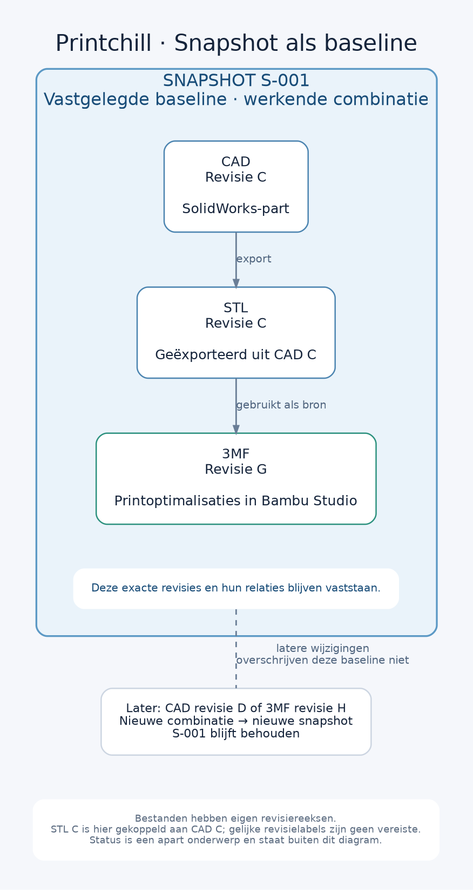

# CAD-properties en versiebeheer in PDM/PLM

**Onderzocht:** 2026-11-11. OpenBOM, Windchill, PRO.FILE, Aras en Teamcenter. Documentatieonderzoek; geen installaties getest. ‘profile’ is geïnterpreteerd als PRO.FILE van Procad/Revalize.

## Hoofdbevinding

Attribute mapping, wijzigingsdetectie en revisiebeheer zijn verschillende functies. Vooral OpenBOM, Windchill en Aras documenteren expliciet een eigen beheerde historie en revisieacties. Geen van de geraadpleegde bronnen beschrijft ‘last saved + bestandsnaam’ als voldoende unieke revisie-identiteit.

Dat bewijst niet dat de pakketten geen timestamps of hashes gebruiken. Hun exacte interne wijzigingsdetectie en hash-algoritmen zijn hier niet vastgesteld.

## Vergelijking

| Pakket | Wat is daadwerkelijk gedocumenteerd? | Les voor Printchill |
| --- | --- | --- |
| OpenBOM | SolidWorks-add-in selecteert CAD-properties en koppelt items via Part Number. Nummer kan uit bestandsnaam, configuratie of custom property komen. Bidirectionele property-uitwisseling. CAD Revision kan apart worden geïmporteerd. Eigen revisies zijn immutable records met bijbehorende bestanden | CAD-revisielabel niet verwarren met systeemrevisie. Bewaar bestanden bij iedere vastgelegde revisie |
| Windchill 13.0.1.0 | Expliciete/impliciete attribute mapping. `PTC_WM_REVISION` en `PTC_WM_ITERATION` komen uit Windchill. Check-in verhoogt iteratie; Revise verandert revisie. Nummer van CAD-document en nummer van bijbehorend Part zijn aparte velden | Beheer identiteit, iteratie, revisie en status afzonderlijk. Een property in CAD kan een spiegel zijn van PDM, niet de autoriteit |
| Aras | Product Engineering 14 beschrijft nieuwe generations bij Claim/Save/Unclaim en onveranderbare Released revisies. Nieuwe wijziging vraagt een nieuwe Preliminary revisie. Programmer’s Guide 2026 specificeert versionable-item-acties. CAD Documents, Parts en bestanden worden gerelateerd beheerd | De historie bestaat in de database. Werkversie en vrijgave onderscheiden; oude relaties blijven inspecteerbaar |
| PRO.FILE | Officiële DMStec-informatie scheidt technische structuren van documenten en ondersteunt n:m-relaties, versiehistorie en audit trails. ECM beschrijft gecontroleerde wijziging/vrijgave | Een model is meer dan een bestand. Ontwerp documentrelaties en lifecycle expliciet |
| Teamcenter | Siemens beschrijft SolidWorks-integratie, versiehistorie, revisies en workflows. Design BOM en EBOM kunnen gescheiden lifecycles hebben, met gecontroleerde onderlinge traceerbaarheid | Gerelateerde objecten hoeven niet gelijktijdig hetzelfde revisielabel te krijgen |

**Bewijsgrens:** PRO.FILE en Teamcenter zijn hier vooral onderbouwd met openbare product-/technische artikelen. Hun specifieke SolidWorks-mappingconfiguratie, gereserveerde propertynamen en exacte file-version-regels zijn niet via een gedetailleerde connectorhandleiding geverifieerd. Voor Aras is de lifecycle concreet gedocumenteerd; propertymapping is connectorafhankelijk en in dit onderzoek niet veld voor veld vastgesteld. Geen universele mappingnamen aannemen.

## Windchill: concreet voorbeeld

De SolidWorks-handleiding noemt:

- `PTC_WM_NUMBER`: nummer van het CAD-document.
- `PTC_WM_PART_NUMBER`: nummer van het actief geassocieerde Part; ander object dan het CAD-document.
- `PTC_WM_REVISION`: revisie uit Windchill; handmatig gewijzigde waarde wordt bij een volgende retrieval/update door de systeemwaarde vervangen.
- `PTC_WM_ITERATION`: iteratie; de connector kan de volgende waarde bij checkout voorspellen.
- `PTC_WM_LIFECYCLE_STATE`: lifecycle-status.
- Optioneel `PTC_WM_CREATED_BY/ON` en `PTC_WM_MODIFIED_BY/ON`: beheerde herkomstgegevens, geen vervanging voor revision/iteration.

Voorbeeld: `A.1 → A.2` bij check-in, `A.2 → B.1` via Revise. De documentatie koppelt dit aan PDM-acties, niet aan iedere lokale Ctrl+S.

Bij expliciete mapping gaan CAD-waarden bij upload naar het CAD-documentobject en PDM-attribuutwaarden bij download terug naar CAD. Mappingrichting en systeemeigenaarschap moeten dus bewust worden ingericht. Niet ieder attribuut is tweerichtingsverkeer met dezelfde prioriteit.

## OpenBOM en Aras: aanvullende inzichten

OpenBOM beschrijft naast automatische change history expliciete immutable revisies van items/BOMs. Bij een revisie blijven de bijbehorende bestanden beschikbaar; een later gewijzigde attachment vervangt die oude revisie niet. De SolidWorks-handleiding laat expliciet een aparte property ‘CAD Revision’ toe.

Aras Product Engineering 14, §3.1, beschrijft generations en revisies apart. Vorige versies zijn read-only. Het hoofdstuk CAD Documents beschrijft native/viewable bestanden, parentrelaties en relaties naar Parts, ook naar een eerdere CAD-documentrevisie.

De Aras Programmer’s Guide 2026, §5.2, preciseert dat `update` een versionable item bij de eerste update sinds locking kan versioneren; de actie `version` maakt een nieuwe generation. De precieze werking hangt af van itemtype, acties en configuratie: ‘iedere save altijd een nieuwe generation’ is te grof.

## Voorstel voor Printchill

> [!info] Begripsafspraak na dit onderzoek
> **Snapshot** betekent voor Printchill een baseline van meerdere specifieke bestandsrevisies met hun relaties. Het betekent niet een enkele bestandsversie of Windchill-iteratie. Status behandelen we apart. Onderstaande voorstellen zijn daarop aangepast.



Dit zijn ontwerpvoorstellen, geen geïmplementeerde of goedgekeurde architectuur.

| Gegeven | Autoriteit / functie |
| --- | --- |
| `model_id` | Printchill; vaste identiteit van een model |
| `document_id` | Printchill; afzonderlijke identiteit per CAD-, STL- of 3MF-document |
| `configuration` | CAD; welke uitvoering is gebruikt |
| `file_version_id` | Printchill; exacte geregistreerde bestandstoestand |
| `snapshot_id` | Printchill; baseline die specifieke bestandsrevisies en hun relaties vastlegt |
| `revision_label` | Printchill; begrijpelijk label zoals C of B |
| `cad_revision_label` | Geïmporteerde CAD-property; apart bewaren van Printchill-revisie |
| `sha256` | Vaststellen van byte-identiteit, geen inhoudelijke vrijgave |
| `last_saved` / bestandstijd | Herkomst en wijzigingssignaal, geen unieke sleutel |
| `state` | Apart onderwerp; voorlopige termen: draft, print-candidate, printed, scrap |

Eenvoudige flow:

1. Extractor leest metadata en configuratie uit een opgeslagen CAD-toestand.
2. Printchill identificeert het document; ontbrekende of conflicterende ID’s vragen een expliciete keuze.
3. Een gecontroleerde import/check-in registreert een nieuwe bestandsversie als de bytes verschillen. Een lokale save is niet automatisch een formele revisie.
4. Printchill bewaart de metadata bij die bestandsversie en legt de exacte bronrelaties vast.
5. De gebruiker legt een werkende combinatie vast als snapshot. Status en statusovergangen worden apart uitgewerkt.

```text
Snapshot S-001 — werkende combinatie
CAD C, bestandsversie cad-17
    ↓ export van vastgelegde configuratie
STL C, bestandsversie stl-23
    ↓ gebruikt in
3MF G, bestandsversie print-42
```

CAD, STL en 3MF hebben onafhankelijke histories. Een snapshot verwijst naar concrete bestandsversies, niet naar ‘latest’. Een opvolgende CAD D verandert de bron van 3MF G in snapshot S-001 niet vanzelf.

### Mappingbeleid

- Configureer welke CAD-property welk Printchill-veld vult, met bron, datatype, scope en richting.
- Bewaar raw properties volledig; map alleen geselecteerde velden naar systeemvelden.
- Gebruik document- en configuratieproperties niet door elkaar. Leg eventuele voorrang vast.
- Laat een import nooit blind een bestaande Printchill-revisie, vrijgavestatus of ID overschrijven.
- Begin met read-only CAD → Printchill. Terugschrijven van beheerde ID’s is een aparte, bewuste exportactie.
- Save As, templates en kopieën kunnen een ingebedde ID dupliceren. Verschillende documenten met dezelfde ID niet automatisch samenvoegen.
- Een gewijzigd tijdstip met dezelfde hash kan een ongewijzigde inhoud zijn. Een andere hash bewijst gewijzigde bytes, niet automatisch gewijzigde geometrie.
- Een algemene model-ID verbindt de reeks; een specifieke bron-bestandsversie bepaalt welke versie daadwerkelijk is gebruikt. De snapshot bewaart de combinatie.

## Wat nog uitzoeken?

- Gedetailleerde PRO.FILE- en Teamcenter-connectorhandleidingen: richting, conflictbeleid en configuratiescope van propertymapping.
- Aras MCAD-connector van de gekozen leverancier: concrete mapping en file-/CAD-documentrevisionering.
- Geen vendorclaim over exacte checksum- of no-op-save-detectie zonder aanvullende technische bron.
- Printchill-POC: twee CAD-saves, metadatawijziging zonder geometriewijziging, Save As met gekopieerde ID en 3MF-update zonder nieuwe STL.

## Bronnen

1. [OpenBOM — SolidWorks-integratie](https://help.openbom.com/my-openbom/openbom-for-dassault-systemes-solidworks/): Part Numbers, CAD Properties, Revisions and Lifecycle, Bi-Directional Data Exchange.
2. [OpenBOM — Change Management and Revision Control](https://help.openbom.com/my-openbom/change-management-and-revision-control/).
3. [OpenBOM — Revisions of Attached Files](https://help.openbom.com/get-started/manage-revisions-of-attached-files/).
4. [Windchill — SolidWorks Default System Attributes](https://support.ptc.com/help/windchill/r13.0.1.0/en/Windchill_Help_Center/WWGMforSolidWorks/WWGMSWAdminWCDefaultSysAttrib.html).
5. [Windchill — Explicit Property-to-Attribute Mapping](https://support.ptc.com/help/windchill/r13.0.1.0/en/Windchill_Help_Center/WWGMforSolidWorks/WWGMSWAdminExplicitPropAttribMap.html).
6. [Windchill — Revisions, Iterations and Versions](https://support.ptc.com/help/windchill/r13.0.1.0/en/Windchill_Help_Center/folders/OverviewFolderRevisIterVers.html).
7. [Aras Product Engineering 14 User’s Guide](https://aras.com/wp-content/uploads/2024/05/Aras-Product-Engineering-14-Users-Guide.pdf): §3.1 en hoofdstuk 8.
8. [Aras Innovator 2026 Programmer’s Guide](https://aras.com/wp-content/uploads/2026/10/aras_innovator_2026_release_-_programmers_guide.pdf): §5.2.
9. [Aras — MCAD connectors](https://aras.com/en/interoperability/mcad).
10. [PRO.FILE — DMStec](https://pro-file.com/dms-document-management-system/) en [Engineering Change Management](https://pro-file.com/engineering-change-management-software/).
11. [Siemens — Teamcenter X Essentials for SolidWorks](https://blogs.sw.siemens.com/teamcenter/teamcenter-x-essentials-solidworks/).
12. [Siemens — Why CAD BOM separation?](https://blogs.sw.siemens.com/teamcenter/why-cad-bom-separation/).

Zie ook [[SOLIDWORKS_JSON_POC]] en [[3MF_METADATA_RESEARCH]].
