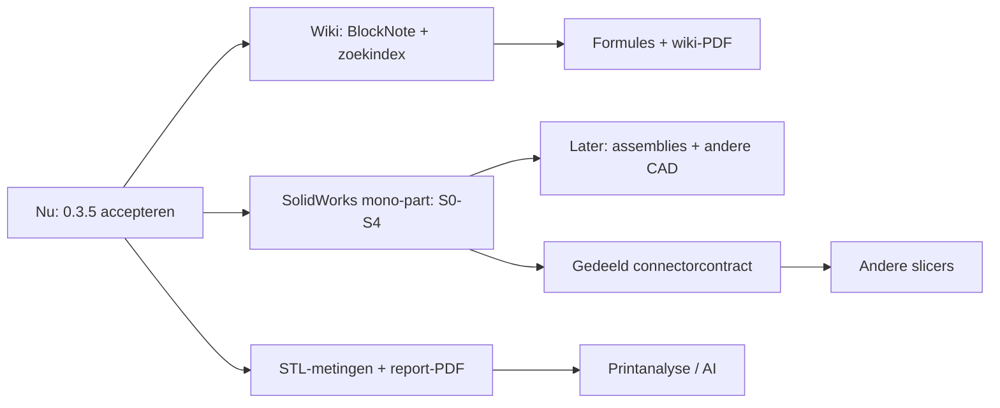

# PrintChill — Roadmap

Stand **2026-11-21 · MVP 0.3.5**. Volgorde op afhankelijkheid en risico; toekomstige releasenummers en datums zijn nog niet toegezegd. Eerst functionaliteit betrouwbaar, daarna verdere UI-verfijning. “Geïmplementeerd” betekent niet automatisch door de gebruiker geaccepteerd.

## Inhoudsopgave

- [[#Route naar de volgende MVP]]
- [[#Huidige stand en acceptatie]]
- [[#Geplande werkpakketten]]
- [[#Toekomstige connectors]]
- [[#Overige productbacklog]]
- [[#Opleveren en testen]]
- [[#Historie]]

## Route naar de volgende MVP

**Advies:** rond de open acceptatie van 0.3.5 af en begin de volgende functionele build met de SolidWorks S0/S1-proef. Dat toetst het belangrijkste nog onbewezen externe koppelvlak. Werk wiki daarna als afzonderlijk pakket uit; beide hoeven niet in één release. Assemblies volgen pas na een betrouwbare mono-partflow.

## Huidige stand en acceptatie

| Gebied | Stand in 0.3.5 | Volgende controle |
| --- | --- | --- |
| Import / revisies · UC-002/005/017/021 | Per rol kiezen/drop; later aanvullen/vervangen; onveranderlijke historie. | Gebruikersacceptatie via T03–T08. Native CAD-flow nog gepland. |
| Bibliotheek / zoeken · UC-006/007/008 | v5-UI, STL-viewer, plaat-PNG's, tags, samengestelde en bewaarde queries. | T09–T16; wiki-zoeken volgt met UC-020. |
| Collecties / History · UC-019/011/012 | Meerdere collecties, afleidingslinks en versiegebonden Git-links. | T17–T20; algemene attachments zijn nog geen volledige UC-012. |
| Reports · UC-003 | Plakken, metingen met nominale waarde, gekozen parameters/suggesties, Enter-beveiliging en Edit. | T21–T31; nog geen modelmeting of PDF-export. |
| Back-up / herstel · UC-015 | Preview, merge en apart herstel; Windows-kiezer. | T01–T02 en T32–T36; upgrade/restore met eigen data beoordelen. |
| Dagelijks Bambu reviseren · UC-018 | Eerder door gebruiker geaccepteerd. | Alleen regressiecontrole bij wijzigingen aan gedeeld versie-/jobbeheer (T37). |
| SolidWorks / Wiki | UI-placeholder en ontwerpdocumenten. | Niet als gerealiseerd of geaccepteerd markeren. |

Eén actuele acceptatietabel: [Testplan builds 0.3.0–0.3.5](../MVP/TESTPLAN.md). Het UC-register bewaart de volledige scopes; bovenstaande tabel beschrijft uitsluitend de daadwerkelijk gebouwde MVP-deelsets.

## Geplande werkpakketten

| Volgorde | Pakket / UC | Afhankelijkheid | Oplevercriterium |
| --- | --- | --- | --- |
| 1 | Acceptatie en gerichte fixes 0.3.5 | Huidige build en samples | Open tests ingevuld; afwijkingen opgelost of expliciet als beperking vastgelegd. |
| 2 | SolidWorks mono-part · UC-002/004/005/021 | S0-compatibiliteitsproef, rolbewuste jobs | CAD openen, nieuw CAD registreren, Save → PRC-confirm en bewezen CAD/STL-export; historie/restore intact. Zie [[SOLIDWORKS_INTEGRATION_PLAN]]. |
| 3 | Basiswiki · UC-020 + UC-008 | Partidentiteit; migratie/back-up; FTS5-proef | Tekst, koppen, lijsten, tabellen, afbeeldingen, pagina's/subpagina's; versiebadges; linkerzoekbalk vindt opgeslagen inhoud; restore herbouwt index. |
| 4 | Wiki-formules · UC-020 | Basiswiki en lokale renderproef | Inline/blok LaTeX bewerken, bewaren en renderen; ongeldige formule toont fout met behoud van bron. Geen automatische rekenengine. |
| 5 | PDF-export · UC-022 | Opgeslagen wiki-/reportbron en gedeelde printweergave | PDF met identiteit, bronrevisie, tekst/tabellen/foto's/formules; lange inhoud zonder afsnijden. Browser Save as PDF eerst, directe exporter na licentie-/renderproef. |
| 6 | Reportmetingen via STL · UC-003 | Exacte STL-revisie, unit- en selectieproef | Bijvoorbeeld modelmaat 101 mm en gemeten 100,8 mm met M-nummer, geselecteerde geometrie en bronrevisie bewaren. Geen onbewezen featureherkenning. |
| 7 | Versievergelijking / relaties · UC-009/013/014 | Betrouwbare export-/bronrelaties | Expliciete versiecontext; “where used” zonder claims op basis van alleen bestandsnamen. Assemblies pas na mono-partconnector. |
| 8 | Printanalyse · UC-023 | Genoeg bruikbare reports, metingen en settings | Engineer selecteert bewijs; advies toont gebruikte versies/parameters en onzekerheid. Geen automatische wijziging of onbewezen kwaliteitsclaim. |

Pakketten 4–6 zijn apart opleverbaar; deze volgorde is geen verplichting ze op één release te wachten. Nieuwe code start pas met uitgewerkte UC-acceptatiecriteria en een begrensde technische proef.

## Toekomstige connectors

| Connector | Eerste scope | Voorwaarde / status |
| --- | --- | --- |
| SolidWorks 2026 | Mono-part openen, save/copy, STL-export en PRC-identiteit | Eerste connector; plan S0–S4. Assemblies en add-in later. |
| Fusion 360 | PRC-Part koppelen, CAD openen/bewaren en STL-export | Backlog; eigen compatibiliteits-/authenticatieproef en UC-004/005-uitwerking vóór implementatie. |
| FreeCAD | `.FCStd`, properties/configuratiecontext en gecontroleerde STL-export | Backlog; toepasselijke FreeCAD-versies eerst bepalen. Sample-inspectie is geen connector. |
| Bambu Studio | Bestaande werkkopieflow en automatische printgegevens | Huidige referentie; regressie behouden. |
| PrusaSlicer | Project openen, bevestigde gewijzigde revisie, beschikbare slicingmetadata | Backlog; project-/G-codecontract en CLI-compatibiliteit onderzoeken. |
| OrcaSlicer | Zelfde gebruikersflow met eigen metadata-/versiecontrole | Backlog; Bambu-afkomst bewijst geen identiek contract. |
| Cura | Native project/3MF openen, save/copy en printmetadata | Backlog; projectscope en instellingen eerst toetsen. |

Alle connectors hergebruiken PRC-identiteit, werkkopieën, inhoudscontrole en expliciete registratie. Geen connector mag een eigen versiegeschiedenis naast PRC aanleggen. Releasenummers en ondersteunde applicatieversies volgen na hun technische proef.

## Overige productbacklog

| Thema | Scope / afhankelijkheid |
| --- | --- |
| Lifecycle · UC-016 | Design state en maturity volgens doelbeleid; geen volledige runtime-claim op basis van prototype v4. |
| Snapshots · UC-010 | Latere baselines over exacte versies van meerdere Parts; geen dagelijkse extra registratiestap. |
| Attachments · UC-012 | Algemene documenten en export; huidige reports/Git-links dekken slechts een deel. |
| Assemblies · UC-013 | Native componentstructuur, externe referenties, configuraties en beheerde assemblywerkkopieën. |
| Nummering | Instelbare Partnummering en beleid bij versie 999; bestaande historische nummers behouden. |
| UI-verfijning | Na functionele acceptatie: consistente uitlijning, dichtheid, toegankelijkheid en bediening; nieuwste v5-feedback blijft leidend. |
| Teamgebruik | Auth, rechten, concurrency, serverdatabase/objectopslag en lokale CAD-agent; geen gedeelde SQLite-map als tussenoplossing. |

## Opleveren en testen

Blijf voorlopig bij de lokale Windows x64-stack, startbaar via VS Code/F5 en `start.cmd`; meegeleverde runtime en appbestanden apart van de workspace. Nieuwe schema's vereisen een volledige voorafgaande migratieback-up. Elke oplevering krijgt een eigen buildversie in app, launcher, pakket en testplantitel, plus relevante unit-/API-/browsertests en handmatige native-appacceptatie.

Commit checkpoints en push naar `origin/main`; releasepakketten bevatten uitsluitend app/runtime/licenties/gebruiksinstructies. Ontwikkeldocumenten blijven in de repository en buiten het releasepakket. Geen nieuwe release-tag voor uitsluitend deze planningswijziging.

## Historie

| Build / proef | Betekenis |
| --- | --- |
| Metadata-POC | Read-only VBA-export (UC-001); geen schrijfconnector. |
| Prototype 1–4 | Ontwerpvalidatie van viewer, versiecontext, reports, structuur en lifecycle; geen volledige productacceptatie. |
| MVP 0.1.x | Lokale import, Bambu-werkkopieën, bevestiging en herstel; UC-018 door gebruiker geaccepteerd. |
| MVP 0.2.x | Bibliotheek, queries, plaatbeelden, reports en back-uppreview. |
| Prototype v5 → MVP 0.3.0 | Goedgekeurde UI naar runtime, collecties en History-vertakkingen. |
| MVP 0.3.1–0.3.3 | Clipboardfoto's, broncontext, meettabel en nominale waarden. |
| MVP 0.3.4 | Import per rol, Edit related objects en gerichte parameterfeedback. |
| MVP 0.3.5 | Expliciet report bewaren, Enter-beveiliging en bestaande reports bewerken. |

Rationale: [[DJF]]. Techniek: [[Architecture]]. Volledige functionele eisen: [[USECASES]].
