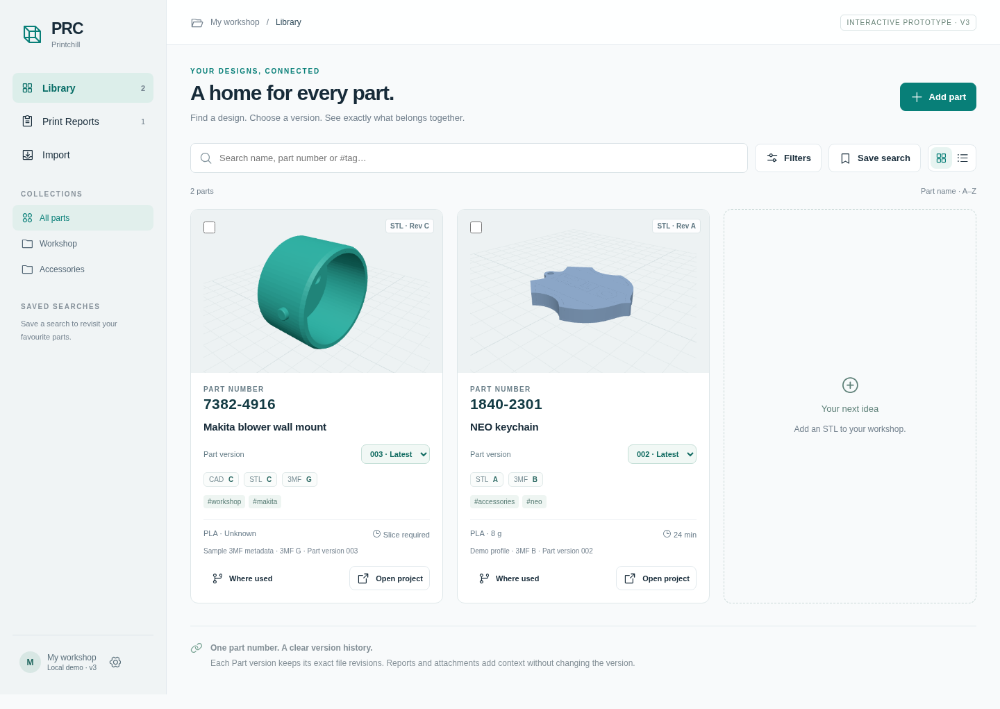
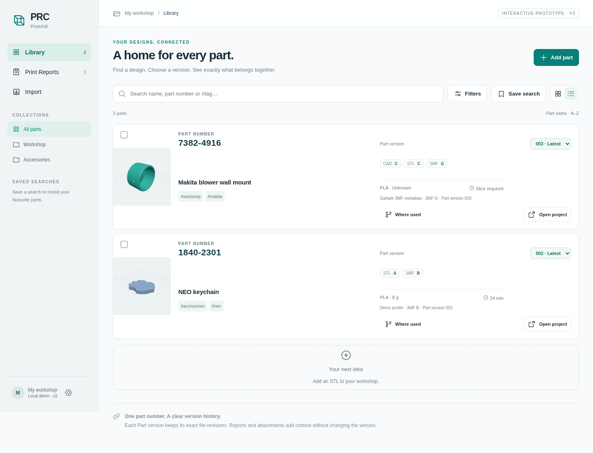
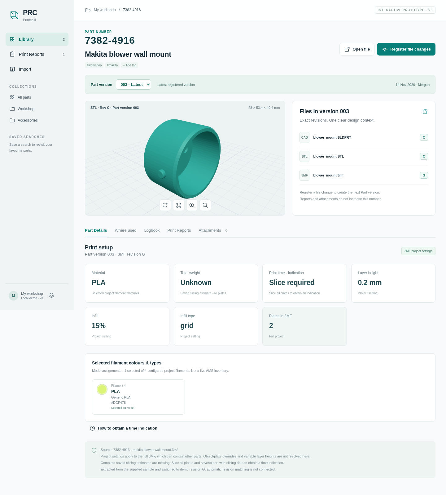
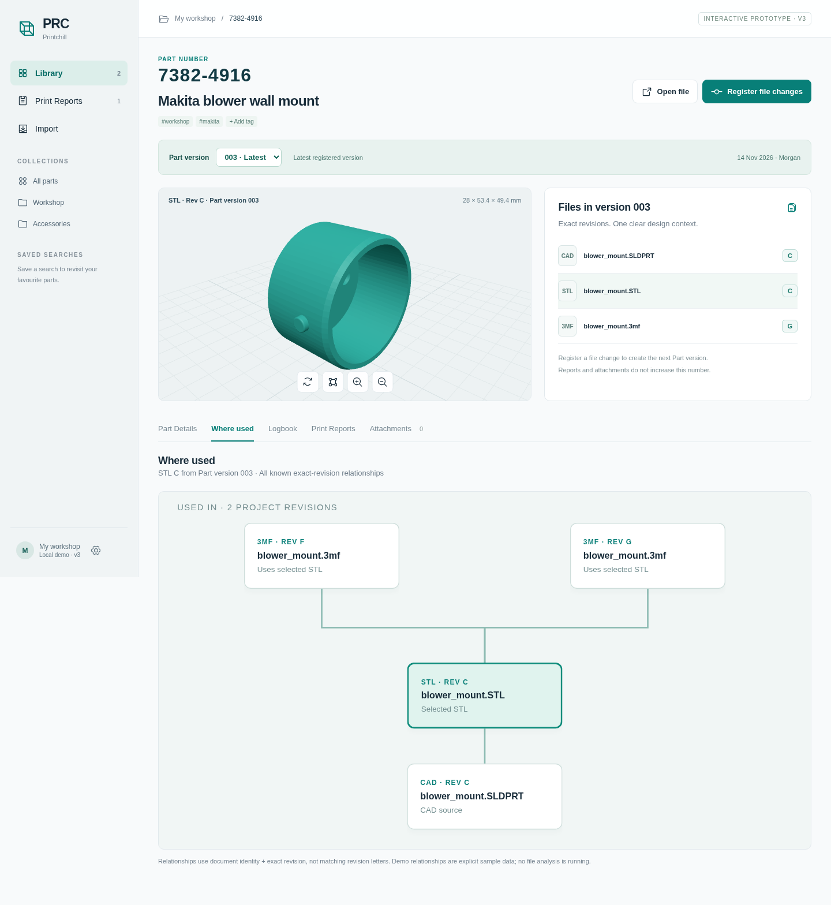
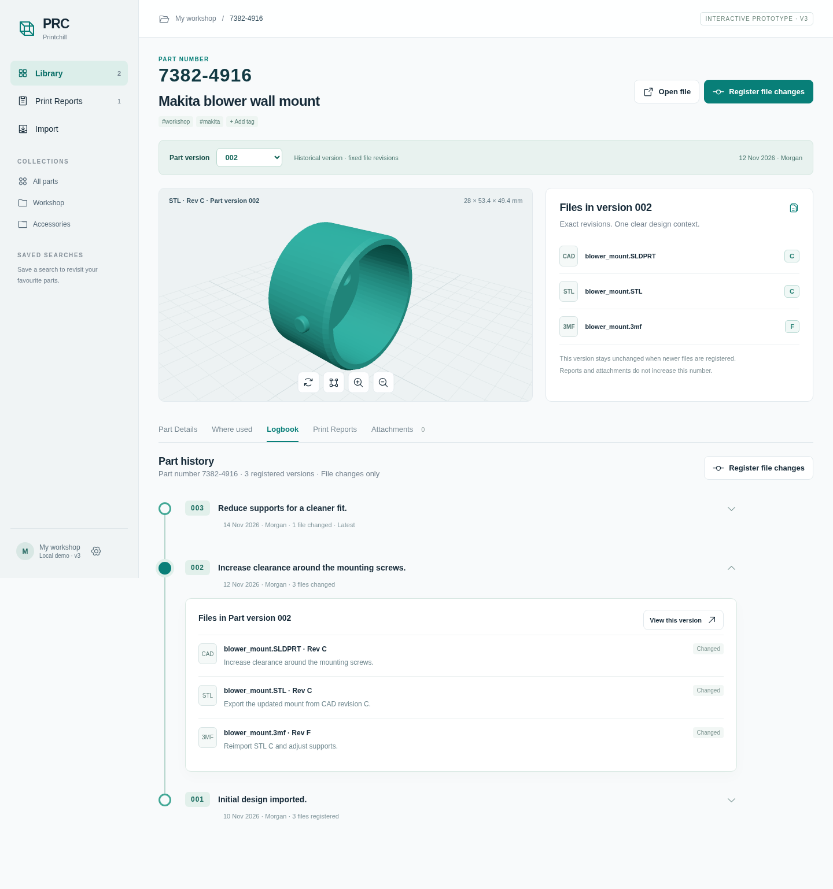
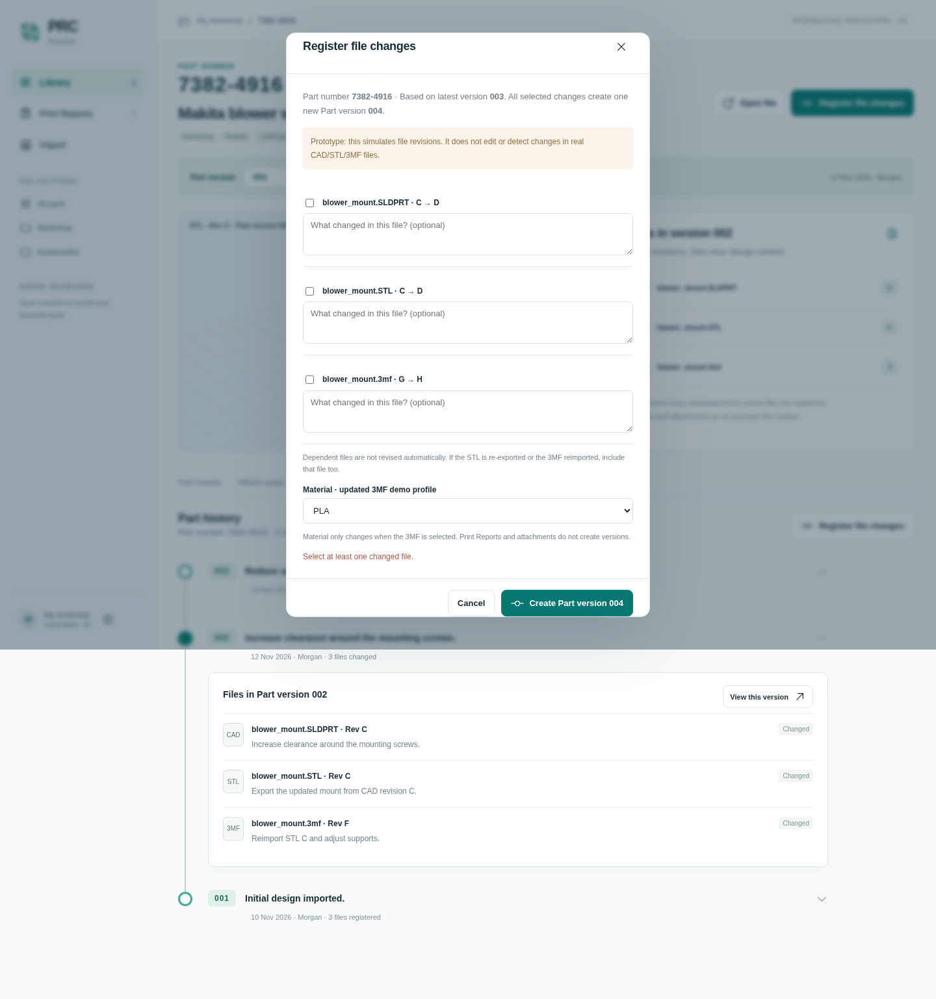
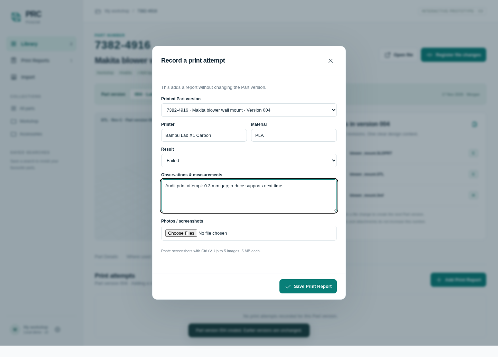
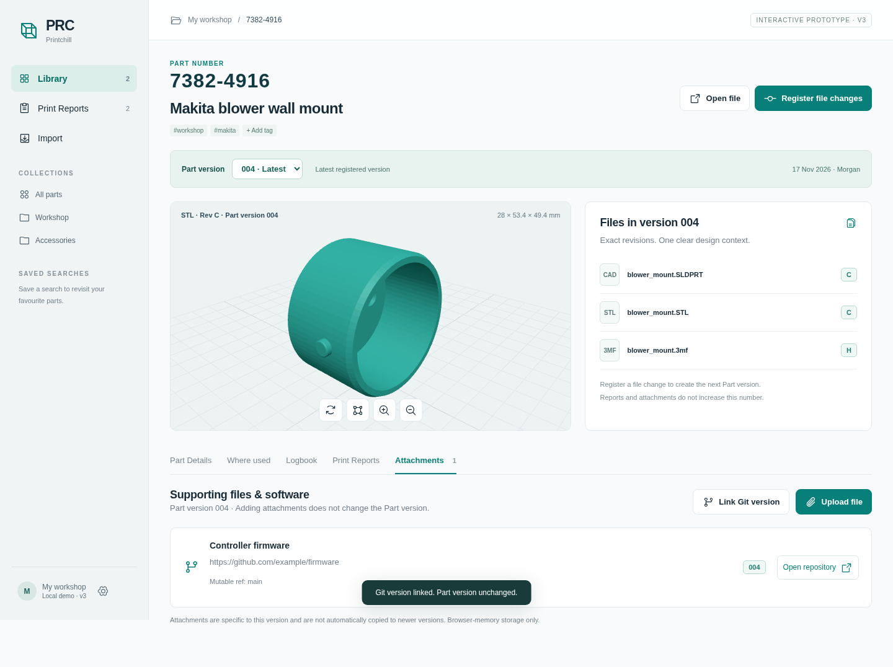
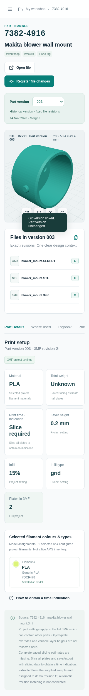

# UI-designonderzoek en toetsing Printchill

Datum: **17 november 2026**. Onderzocht: huidige demo v3, commit `f0f3f04`, standalone HTML. [Downloadbaar verslag met ingebedde screenshots](UI_DESIGN_REVIEW.html).

## Oordeel

**Goede basis voor visueel Part- en versiebeheer; nog niet klaar als dagelijks engineeringgereedschap.** Identiteit, bestandscontext, relaties en wijzigingshistorie zijn sterk. De grootste gaten zitten in leesbaarheid/toegankelijkheid, bewaren en herstellen van werk, expliciete bewerkingscontext en efficiënt vergelijken van veel records.

Dit is een beoordeling van het prototype. Ontbrekende opslag en connectors zijn bekende prototypegrenzen; het zijn geen nieuw ontdekte productieregressies. Ze moeten wel opgelost of opvallend benoemd zijn voordat gebruikers de demo als echt beheersysteem gebruiken.

## Onderzoek: wat zeggen de bronnen?

| Bron | Bruikbare richtlijn | Vertaling naar Printchill |
| --- | --- | --- |
| [NN/g — 8 Design Guidelines for Complex Applications](https://www.nngroup.com/articles/complex-application-design/) | Ondersteun niet-lineair werk, werkhervatting, efficiëntere methoden, contextwissels en zichtbare kerninformatie | Niet alleen mooie kaarten: snel vinden, vergelijken, reviseren en hervatten |
| [NN/g — Complex-Application Design: A 5-Layer Framework](https://www.nngroup.com/articles/complex-application-design-framework/) | Integratie, informatiemassa en werkomgeving zijn onderdeel van UX | CAD/slicerhandoff en betrouwbare gegevenscontext zijn even belangrijk als vormgeving |
| [NN/g — Data Tables: Four Major User Tasks](https://www.nngroup.com/articles/data-tables/) | Tabellen ondersteunen vinden, vergelijken, records bewerken en acties uitvoeren | Kaarten voor herkennen; aanvullende compacte, sorteerbare tabel voor veel Parts |
| [IBM Carbon — Data table](https://www.carbondesignsystem.com/building-blocks/core/components/data-table/guidelines) | Uitgelijnde kolommen, sorteren, zoeken/filteren, selectie en batchacties | Consistente bedieningsbalk en echte tabelweergave naast het raster |
| [IBM Carbon — Form](https://www.carbondesignsystem.com/building-blocks/core/components/form/guidelines) | Zichtbare labels, bruikbare defaults, duidelijke fouten en onderscheid tussen read-only en disabled | Per bestand weten wat verandert; fouten bij relevante invoer; expliciete bronversie |
| [NN/g — Progressive Disclosure](https://www.nngroup.com/articles/progressive-disclosure/) en [10 heuristieken](https://www.nngroup.com/articles/ten-usability-heuristics/) | Houd de hoofdtaak eenvoudig, toon details op aanvraag, voorkom fouten en maak herstel mogelijk | Tabs en uitklapbare historie behouden; verlies van invoer voorkomen |
| [Onshape — Versions and History](https://cad.onshape.com/help/Content/Document/versions_and_history.htm) | Onderscheid tussen vaste, alleen-lezen versies en bewerkbare werkcontext; geschiedenis en vergelijking | Oude Part versions duidelijk als historisch behandelen; bewerkingsbasis expliciet maken |
| [Bentley iTwinUI](https://itwinui.bentley.com/) en [Siemens Industrial Experience](https://github.com/siemens/ix) | Engineering-/industriesoftware gebruikt consistente componenten, patronen en toegankelijke layouts | Werk met herbruikbare componenten en tokens, niet met unieke interactieregels per tab |
| [WCAG 2.2 — contrast](https://www.w3.org/WAI/WCAG22/Understanding/contrast-minimum.html), [keyboard](https://www.w3.org/WAI/WCAG22/Understanding/keyboard.html), [target size](https://www.w3.org/WAI/WCAG22/Understanding/target-size-minimum.html), [reflow](https://www.w3.org/WAI/WCAG22/Understanding/reflow.html) | Leesbaarheid, toetsenbordtoegang, bruikbare klikdoelen en vergroting | Concrete kwaliteitseisen, ook voor technische gebruikers |
| WAI-ARIA APG: [tabs](https://www.w3.org/WAI/ARIA/apg/patterns/tabs/) en [dialogs](https://www.w3.org/WAI/ARIA/apg/patterns/dialog-modal/) | Verwachte toetsen en toegankelijke namen/relaties | Correcte tabnavigatie en benoemde modale formulieren |
| [WAI-ARIA — Tooltip](https://www.w3.org/WAI/ARIA/apg/patterns/tooltip/) en [WCAG 1.4.13 — Content on Hover or Focus](https://www.w3.org/WAI/WCAG22/Understanding/content-on-hover-or-focus.html) | Korte uitleg via hover én toetsenbordfocus; sluitbaar, aanwijsbaar en blijvend zolang nodig | Vooral icoonknoppen verduidelijken; essentiële uitleg zichtbaar houden |

**Interpretatie:** de eerste acht rijen leveren heuristieken, componentpatronen en productvoorbeelden; geen verplichte PDM-norm. WCAG bevat toetsbare criteria; de Understanding-pagina’s lichten die toe. APG beschrijft aanbevolen widgetpatronen. Onshape’s volledige branching-/releasemodel hoeft Printchill niet over te nemen. Een dark mode, ribbon, vaste zijbalkbreedte of een bepaalde kleur is geen universele engineeringbest practice.

Bronnen zijn tijdens deze audit online gelezen. De Siemens Digital Industries-designsite was niet bereikbaar; alleen de bereikbare openbare Siemens IX-README is gebruikt, zonder claims over ongelezen richtlijnen.

## Toetsing aan de demo

Voldoet = aangetoond binnen de geteste prototypeflow. Deels = aanwezig met concrete gaten. Niet = getoetst aspect ontbreekt of vertoont een aantoonbaar probleem. Dit is geen WCAG-certificering of totaalscore.

| Onderwerp | Oordeel | Bewijs en gevolg |
| --- | --- | --- |
| 1. Part-identiteit en versiecontext | **Voldoet** | Prominent Part number, aparte Part version en concrete CAD/STL/3MF-revisies. Historische selectie is gelabeld. Stap 2/4 |
| 2. Traceerbare relaties | **Voldoet** | STL C staat tussen CAD C en gebruikende 3MF F/G; exacte revisies zichtbaar. Stap 3 |
| 3. Historie en reden van wijziging | **Voldoet** | Logbook met tijdstip, auteur, versienummer, gewijzigde bestanden en comments per bestand. Stap 4 |
| 4. Details op aanvraag | **Voldoet** | Tabs, uitklapbare Logbook-entry en aanvullende tijdhulp beperken de eerste informatielaag. Stap 2/4 |
| 5. Eerlijkheid over gegevens | **Voldoet** | Unknown, Slice required, bronbestand en geselecteerd versus geconfigureerd filament worden onderscheiden. Stap 2 |
| 6. Report/attachment zonder versieophoging | **Voldoet** | Report en Git-link toegevoegd aan 004; Part version blijft 004. Mutable ref wordt benoemd. Stap 6/7 |
| 7. Vinden en herhaalde selectie | **Deels** | Naam/nummer/tags, filters, bewaarde zoekopdrachten en batchtags aanwezig. Zoeksyntaxis is weinig uitgelegd; opslag verdwijnt bij herladen. Stap 1 + broncode |
| 8. Veel Parts vergelijken | **Niet** | List view blijft grote kaarten in rijen; geen uitgelijnde vergelijkingskolommen of sorteerbare headers. ‘Part name · A–Z’ is tekst, geen sorteeractie. Stap 1b |
| 9. Twee revisies vergelijken | **Deels** | Historie en vaste bestandslijsten bestaan, maar geen A/B-vergelijking van geometrie of 3MF-parameters. Historische geometrie is een simulatie. Stap 4 + broncode |
| 10. Taakgerichte informatiedichtheid | **Deels** | Rustig en herkenbaar, maar op 1366×768 begint de eerste detailwaarde pas op y≈851, onder het scherm. Viewer en kop blijven ook boven Logbook/Attachments groot. Stap 2 |
| 11. Veilige wijzigingscontext | **Deels** | Validatie zonder file-selectie werkt. Vanuit 002 maakt de dialoog echter een wijziging op basis van latest 003. Dit staat vermeld, maar verdient een expliciete overgang. Stap 5 |
| 12. Werk bewaren en herstellen | **Niet** | Escape sluit een ingevuld report zonder waarschuwing; bij heropenen is de tekst leeg. Na reload verdwijnt ook nieuwe 004. Geen Undo/herstel. Stap 6 + herlaadcontrole |
| 13. Tekstcontrast | **Niet** | Detailhulptekst 2,89:1; inactieve tabtekst 3,51:1; tagtekst 4,24:1. Dit ligt onder 4,5:1 voor deze gewone tekst. Stap 1/2 |
| 14. Toetsenbord en toegankelijke semantiek | **Deels** | Knoppen en native selecties zijn bedienbaar; dialog houdt Tab binnen en Escape sluit. Pijltjestoetsen wisselen geen tabs; panel mist tabpanel-rol; dialog mist toegankelijke naam. Stap 2/5 |
| 15. Mobiele reflow en klikdoelen | **Deels** | Op 320 CSS-pixels geen horizontale paginascroll. Tabs zijn wel breder dan hun strook; toast kan viewerknoppen tijdelijk bedekken. Selectievakjes zijn 17×17, versiebolletjes 22×22. Stap 8 |
| 16. Engineeringstatus en toolhandoff | **Deels / MVP-gat** | De architectuur beschrijft design-/maturity-states, maar UI toont die nog niet. CAD/slicer openen is een aangekondigde demoactie zonder connector. Broncode/architectuur; geen echte toolhandoff getest |
| 17. Tooltips en herkenbaarheid van iconen | **Deels / ontbrekende visuele hulp** | Viewerknoppen en Settings hebben aria-labels, maar geen tooltipimplementatie in de huidige broncode. Een aria-label is geen zichtbare tooltip. Broncodecontrole bij stap 1/2; hover-/focustooltips niet als gerealiseerd getest |

### Concrete meetresultaten toegankelijkheid

| Element | Voorgrond / achtergrond | Gemeten | Vereist voor deze tekst |
| --- | --- | --- | --- |
| Detail-helper, 10 px | `#8A9B9F` / `#FFFFFF` | **2,89:1** | ≥ 4,5:1 |
| Inactieve tab, 13 px | `#778892` / `#F8FAFB` | **3,51:1** | ≥ 4,5:1 |
| Klikbare tag, 10 px | `#567B73` / `#EEF5F2` | **4,24:1** | ≥ 4,5:1 |
| Actieve tab, 13 px | `#087F78` / `#F8FAFB` | **4,65:1** | ≥ 4,5:1 — voldoet |

Berekend uit browser-computed styles en de dichtstbijzijnde ondoorzichtige achtergrond. Deze tekst is geen disabled/decoratieve inhoud. Dit bevestigt tekortkomingen voor WCAG 1.4.3 op de onderzochte elementen; niet de volledige applicatie.

Kleine fonts zijn op zichzelf geen automatische WCAG-overtreding, maar 9–11 px vergroot de leesinspanning bij langdurig werk. Bij klikdoelen geldt WCAG 2.5.8: 24×24 px of een toepasselijke uitzondering/afstand. Een 22-px bolletje heeft hier ook een grotere equivalente klikbare samenvatting; de maat alleen bewijst dus geen overtreding. Advies: grotere hit areas en spacing controleren, niet alleen iconen vergroten.

### Tooltips — richtlijnen en toepassing

Tooltips waren nog niet expliciet beoordeeld. Deze aanvulling is gebaseerd op de huidige broncode en de gelinkte W3C-bronnen; geen nieuwe tooltipinteractie is gerealiseerd of getest.

- **Gebruik:** korte uitleg bij icoonknoppen of compacte technische termen. Voorbeelden in de Engelstalige UI: `Reset view`, `Show dimensions`, `Zoom in`, `Zoom out`, `Settings`, `Grid view` en `List view`.
- **Aanvullend:** vermeld een sneltoets alleen als die echt bestaat. Geef bij onbekende engineeringtermen een korte betekenis, niet alleen een herhaling van de afkorting.
- **Geen verborgen vereisten:** Part number, geselecteerde versie, eenheden, foutmeldingen, broncontext en consequenties van wijzigingen blijven zichtbaar. Tooltips vervangen geen veldlabels, bestaande inline hulp of goede knopnamen.
- **Interactie:** toon dezelfde uitleg bij muishover en toetsenbordfocus. Laat focus op de trigger; een tooltip bevat geen links, knoppen of andere focusbare inhoud. Langere of interactieve uitleg hoort in een help-popover of dialoog.
- **Toegankelijkheid:** geef de tooltip `role="tooltip"` en koppel aanvullende uitleg met `aria-describedby`. Behoud een passende toegankelijke naam voor de knop; `aria-label` alleen toont niets voor ziende gebruikers. Vermijd onnodig dubbele voorlezing van naam en uitleg.
- **Gedrag:** Escape sluit de tooltip zonder focus te verplaatsen. De gebruiker moet de muis over de tooltip kunnen bewegen zonder dat hij verdwijnt. Geen automatische timeout zolang trigger/tooltip wordt aangewezen of triggerfocus behouden blijft; sluiten bij focus-/hoververlies of niet meer geldige informatie.
- **Touch:** belangrijke functies hebben een herkenbaar label of expliciete helpactie; geen functionaliteit uitsluitend achter hover. Geen eerste tik die onverwacht zowel hulp opent als een wijziging uitvoert.
- **Vormgeving:** compact, voldoende contrast en nabij de trigger; niet afgesneden door de viewport en niet over relevante invoer of bediening. Vertraging/positionering zijn productkeuzes, geen vaste WCAG-millisecondennorm.

**Acceptatie voor een volgende iteratie:** icoonacties zijn begrijpelijk via hover én focus; Escape, aanwijsbaarheid, levensduur, schermranden, vergroting en touch zijn gecontroleerd. Essentiële informatie blijft zonder tooltip beschikbaar.

WCAG 1.4.13 kent uitzonderingen, waaronder native browsertooltips via `title`; zo’n uitzondering maakt `title` nog geen betrouwbare oplossing voor toetsenbord- en touchgebruik. Het APG-tooltip-patroon is bovendien expliciet een werk-in-uitvoering, geen afgeronde norm. Bovenstaande aanbeveling combineert dat patroon met WCAG en duidelijke UI-labels.

## Prioriteiten voor de volgende iteratie

| Prioriteit | Aanpassing | Concreet gereed wanneer |
| --- | --- | --- |
| **P1** | Leesbaarheid en basis-toegankelijkheid | Teksttokens halen contrast; tabs hebben consistente pijltjestoetsbediening en panelrelaties; dialogs hebben een toegankelijke naam |
| **P1** | Onbedoeld verlies van invoer voorkomen | Een reportdraft overleeft sluiten of vraagt bevestiging; duidelijk onderscheid tussen tijdelijk en duurzaam opgeslagen; herstel vóór dagelijks gebruik |
| **P1** | Geloofwaardige versie-/bewerkingscontext | ‘Viewing 002 / Editing latest 003 → 004’ expliciet; historische geometrie gebruikt juiste revisie of heeft een blijvend, zichtbaar sample-label bij de viewer |
| **P2** | Echte engineeringtabel naast raster | Uitgelijnde kolommen: Part number, naam, Part version, CAD/STL/3MF, materiaal, tijdindicatie; sorteren, filters en batchacties |
| **P2** | A/B-vergelijking | Kies twee Part versions; toon gewijzigde bestanden/3MF-instellingen en later geometrieverschillen met broncontext |
| **P2** | Compacte inspectiemodus | Kerngegevens ook op een normale laptop direct zichtbaar; grote viewer optioneel/inklapbaar; geselecteerde versie blijft herkenbaar |
| **P2** | Gepland statusbeleid zichtbaar maken | Design state en maturity apart tonen; wijzigingsacties volgen het vastgestelde beleid. Geen nieuw statusmodel ontwerpen in deze audit |
| **P2** | Consistente tooltips voor icoonacties | Hover en focus tonen korte Engelse uitleg; Escape werkt; geen timeout tijdens gebruik; touch heeft een alternatief; essentiële labels blijven zichtbaar |
| **P3** | Sneller routinematig werken | Deelbare Part/version-links, herkenbare zoeksyntaxis, instelbare kolommen en bescheiden sneltoetsen met zichtbare uitleg |

P1 = oplossen vóór een betrouwbare veldproef/dagelijks gebruik; P2 = belangrijke efficiëntieverbetering; P3 = verdere versnelling. Voor deze audit is geen UI-code aangepast en geen nieuw ontwerp opgelegd.

## Vastgelegde flow en screenshots

Alle screenshots zijn nieuw gemaakt en geopend tijdens deze audit. De demo-data is alleen in een tijdelijke browsersessie gewijzigd.

### Stap 1 — Bibliotheek: deels goed

Zoekopdracht `#workshop + PLA` levert het juiste Part. Identiteit en previews zijn duidelijk; belangrijke microtekst is klein. De lijststand biedt nog geen efficiënte tabelvergelijking. Toegankelijkheidsrisico: tagcontrast en kleine selectiedoelen. Geen schaaltest met grote bibliotheken uitgevoerd.

### Stap 2 — Part Details: goede context, leesbaarheid onvoldoende

003 bevat CAD C/STL C/3MF G. Alleen geselecteerd filament 4 wordt getoond. Unknown en Slice required zijn eerlijk. Te veel schermhoogte vóór de kerngegevens; lichte hulptekst en inactieve tabs halen contrast niet. Pijltjestoetscontrole op de tab blijft op Part Details staan.

### Stap 3 — Where used: goed voor de huidige kleine keten

Vier blokken en drie verbindingslijnen maken de keten begrijpelijk. Revisies zijn leesbaar gelabeld. Nog geen grote assemblagegraaf, filters, compare-flow of volledige keyboard-/screenreadergraph getest; geen claim over schaalbaarheid.

### Stap 4 — Logbook: sterk begin, vergelijking ontbreekt

Historische selectie 002 en de bestandscombinatie zijn herkenbaar. Bolletje en samenvatting openen dezelfde entry met file-comments. A/B-vergelijking ontbreekt. Kleine tekst/bolletjes vragen aandacht; grotere samenvatting biedt een equivalente actie. Geen geometrievergelijking uitgevoerd.

### Stap 5 — Wijziging registreren: deels veilig

Zonder geselecteerd bestand verschijnt een herstelbare fout. Vanuit 002 vermeldt de dialoog expliciet latest 003 als basis voor 004; deze contextwissel kan duidelijker. Tab blijft in het modale venster en Escape werkt. De dialog heeft wel een zichtbare titel, maar geen gekoppelde toegankelijke naam. Per-file commentvelden zijn ook vóór selectie actief; staged disclosure zou de intentie verduidelijken.

### Stap 6 — Print Report: juiste koppeling, geen draftbescherming

Report kan als Failed aan 004 worden opgeslagen zonder nieuwe Part version. Eerst is proeftekst ingevuld en met Escape gesloten: bij heropenen was het veld leeg, zonder waarschuwing. Focusrand is zichtbaar; native labels zijn aanwezig. Foto-upload/plakken en assistieve voorlezing zijn in deze audit niet opnieuw getest.

### Stap 7 — Attachments: juiste versiecontext, tijdelijke opslag

Git-link toegevoegd aan 004; versienummer blijft gelijk. `main` staat terecht als Mutable ref. Een vaste commit verdient de voorkeur voor reproduceerbare software. Geen repository-/commitvalidatie, bestandsupload of externe navigatie uitgevoerd. Bijlagen zijn bewust niet duurzaam opgeslagen in deze demo.

### Stap 8 — Mobiel 320 px: bruikbaar, verdere afwerking nodig

Paginabreedte is 320 px zonder horizontale paginascroll. Tabstrook heeft 460 px inhoud in 288 px beschikbare ruimte; vervolg-tabs zijn daardoor niet direct zichtbaar. Toast bedekt tijdelijk viewerbediening; gegevenspagina wordt erg lang. Deze check is geen volledige 400%-zoom-/touchtest.

## Bewijs en beperkingen

- Browser: nieuw, gecontroleerd headless Chromium met software-WebGL; desktop 1440×1000, aanvullende laptopmeting 1366×768 en mobiel 320×850. Geen toegang tot de lege Companion Page of een gedeelde ingelogde browsertab; die was ook niet nodig voor deze lokale demo.
- Exact getoetst: `prototype/Printchill-demo.html`, SHA-256 `d59ea2ced4b71f801be60bd951036715b9b629985728290dfd0ececa727ee3f3`. De module-UI en download zijn hetzelfde ontwerp, niet twee onafhankelijke varianten. Eerdere mock-ups zijn niet opnieuw beoordeeld.
- [Observaties en computed styles](images/ui-audit-2026-11-17/observations.json); DOM/ARIA-snapshots staan naast de screenshots. Geen JavaScript-pageerrors in de auditflow.
- Oude 001 toont in de viewer ‘STL Rev B’, maar de broncode laadt één STL per Part voor alle versies. De README meldt dit; naast de historische viewer ontbreekt een blijvend geometrie-samplelabel. Dit is een prototypegat, geen bewijs van onjuiste echte revisieopslag.
- Herladen is getest: aangemaakte 004 verdwijnt, alleen 003/002/001 blijven over. De demo meldt geheugenopslag, maar dat maakt Save nog niet duurzaam of herstelveilig.
- Geen volledige WCAG-audit, screenreadertest, cross-browsermatrix, CAD-/slicerhandoff, backend, rechtencontrole, prestatietest of gebruikersstudie. Een geslaagde kleine flow bewijst geen productiegeschiktheid.
- Review met makers/kleine bedrijven blijft nodig: laat deelnemers een Part vinden, twee versies vergelijken, een wijziging registreren en een printpoging terugvinden. Meet taaksucces, verkeerde versiekeuzes, herstelfouten en benodigde tijd.

## Verwerking in prototype 4

Deze aanvulling beschrijft de nieuwe implementatie. De bovenstaande metingen, screenshots en beperkingen blijven het historische verslag van prototype 3.

| Reviewpunt | Verwerking en resterende grens |
|---|---|
| Informatiedichtheid en engineeringtabel | Compacte inspectiepagina, kerngegevens boven de vouw op laptop, sorteerbare tabel met kolomkeuze. |
| Historische versiecontext | Afzonderlijke echte A/B-STL-previews waar aangeleverd; Viewing versus Editing latest expliciet. Gesimuleerde veranderingen blijven herkenbaar. |
| Vergelijken | Bestandsrevisies, hashes en 3MF-instellingen naast elkaar; echte STL-previews. Geen berekening van geometrische afwijkingen. |
| Contrast en bediening | Donkerdere hulptekst/tabs, grotere doelen, focusranden; gerichte contrastmeting minimaal 4.5:1. Geen volledige WCAG-claim. |
| Tabs en dialogen | Pijltjestoetsen/Home/End, gekoppelde tabpanelen en dialoogtitels; gecontroleerd in Chromium. |
| Tooltips | Hover en toetsenbordfocus, gekoppelde beschrijving, persistent bij hover, Escape sluit zonder focusverlies; belangrijke informatie blijft zichtbaar in de pagina. |
| Drafts en opslag | Reportdrafts, foto's en bijlagen in IndexedDB; backup-export en bevestigd herstel. Geen cloudopslag of serverbackup. |
| Veilige wijziging | File-comments pas na selectie; Released-bevestiging; lifecyclegrenzen; reports/bijlagen zonder Part-versionverhoging. |
| Navigatie | Deep links naar Part/version/tab, zoekshortcut en lokale opgeslagen zoekopdrachten. |
| Mobiel en feedback | 320 px zonder paginabrede overflow; toast bovenaan; diagrammen en brede tabellen schuiven lokaal. |
| Bronnen en assemblies | Expliciete bronzekerheid, echte 3MF-componenten en platen. Native SLDASM-childstructuur vereist nog een Windows/SolidWorks-export. |

Verificatie: 12 JavaScript- en 9 Python-tests, productiebuild en volledige browserflows via ontwikkelserver en zelfstandig HTML slagen. Backup/herstel met geïmporteerde STL is meegenomen. De assembly-manifesttest is synthetisch; de nieuwe VBA-macro is nog niet op Windows gecompileerd of uitgevoerd. Geen volledige screenreader-, cross-browser- of gebruikersstudie uitgevoerd.

Zie [UI-controle prototype 4](../prototype/design-qa.md) voor bewijs en [materiaalanalyse](SAMPLE_ANALYSIS.md) voor de onderbouwing van relaties en ontbrekende gegevens.
